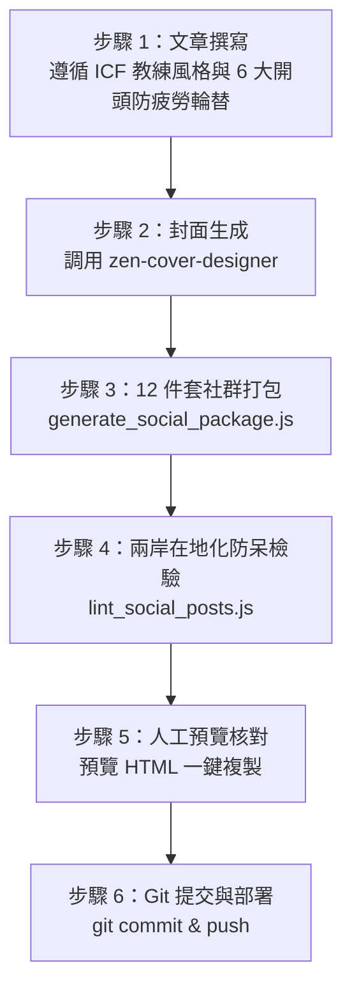

# 心茶記 文章撰寫與全自動社群分發管線 (Mind Tea Publishing Pipeline)

本技能為《心茶記》(Mind Tea Journal) 之核心出版發行管線，統籌「文章撰寫 $\rightarrow$ 封面生成 $\rightarrow$ 12 件套社群分發包產製 $\rightarrow$ 兩岸語彙防呆檢驗 $\rightarrow$ Git 版本控制與遠端部署」全流程。

---

## 🚀 完整出版發行六步走管線



---

### 步驟 1：文章撰寫規範 (`_posts/YYYY-MM-DD-<slug>.md`)

1. **ICF 專業教練精神（去說教鐵律）**：
   - 保持並肩探索的夥伴關係，堅決避免居高臨下的指導或指責。
   - 避免「你應該」、「你必須」，轉化為好奇提問與覺察邀請。
   - 貫穿四大基石：自我覺察、深層價值觀、正向空間、微行動。
2. **六大開頭模型輪替（嚴防審美疲勞）**：
   - **嚴格禁止**動輒使用公式化的「你有沒有過這樣的時刻？」、「你一定遇過這種情況：」。
   - 每篇新文章強制在 6 大模型中輪替：
     - **模型 1：現場微對話 / 留白切入**（以一段真實教練對話或寂靜留白開場）
     - **模型 2：畫面定格 / 感官白描切入**（如茶湯熱氣、窗外雨絲、桌面震動的手機）
     - **模型 3：反直覺觀點 / 認知翻轉切入**（挑戰常識，如「憤怒不是壞事」）
     - **模型 4：客觀現象白描 / 人類心智觀察**（如傳播學媒介豐度、大腦神經機制）
     - **模型 5：哲人思想 / 詩意隱喻切入**（如布伯「我與你」、地圖與疆域）
     - **模型 6：身心覺受 / 落地共振切入**（如緊繃的咬肌、懸在喉頭的呼吸）
3. **文章五步結構**：
   - 生活/教練現場切入 $\rightarrow$ 底層心理機制拆解 $\rightarrow$ 有力提問（留白） $\rightarrow$ 溫和微步實驗 $\rightarrow$ 溫潤金句收尾。
4. **Frontmatter 格式**：
   ```yaml
   ---
   layout: post
   title: "主標題：副標題"
   subtitle: "心茶記專欄精選"
   date: YYYY-MM-DD
   permalink: /post/<slug>/
   categories: [自我覺察, 溝通藝術]
   tags: [ICF教練, 傾聽, 心理安全]
   author: Sunny
   cover_image: assets/social/<slug>.jpg
   ---
   ```

---

### 步驟 2：生成禪意封面 (`zen-cover-designer`)

1. 調用 `image-generator` 子代理，輸入符合 [`zen-cover-designer`](../zen-cover-designer/SKILL.md) 規範之提示詞。
2. 圖片產出後，執行歸檔腳本：
   ```bash
   node .agents/skills/zen-cover-designer/scripts/archive_cover.js <來源圖片路徑> <postSlug> <targetSocialDirName>
   ```

---

### 步驟 3：全自動生成 13 項社群與短影音分發包

執行分發包產生器：
```bash
node .agents/skills/mindtea-publish/scripts/generate_social_package.js _posts/YYYY-MM-DD-<slug>.md
```

腳本會自動在 `social_posts/YYYY-MM-DD_主題名/` 中建立完整 13 項資產：
1. `01_Facebook.txt`（繁體，走心故事體）
2. `02_LinkedIn.txt`（繁體，自我領導力與職場心理安全）
3. `03_Threads.txt`（繁體，高密度短金句與大間距留白）
4. `04_方格子.md` 與 `04_方格子.txt`（**100% 繁體字 + 台灣在地語彙**，文末附作者簡介與雙 QR Code 指引）
5. `04_方格子_富文本預覽.html`（內建「一鍵複製富文本」按鈕，格式完美貼入編輯器）
6. `05_微信朋友圈與群.txt`（簡體，晨光問候與教練反思微問題）
7. `06_小紅書.txt`（簡體，痛點標題、條列 emoji 排版、**零外部連結**、心茶記搜尋指引）
8. `07_知乎.md` 與 `07_知乎.txt`（簡體深度專欄版）
9. `07_知乎_富文本預覽.html`（內建「一鍵複製富文本」按鈕）
10. `08_短視頻腳本.txt`（**30 秒短影音分鏡腳本**：五大風格模型輪替、分秒鏡頭、純旁白文字與 AI 畫面 Prompt）
11. `cover.jpg`（已由步驟 2 歸檔）

---

#### 🎬 30 秒短影音五大風格模型（防腳本審美疲勞）
依文章開頭與核心心理機制，自動輪替五大風格：
- **風格 1：教練現場微對話型**（沉浸偷聽感，以真實對談直擊心理防禦）
- **風格 2：身心覺察引導型**（30 秒數位冥想與 ASMR，引導身體落地）
- **風格 3：認知翻轉暴擊型**（打破常識的反直覺高能洞察）
- **風格 4：職場日常鏡像型**（生活與視訊會議困境還原，強烈共鳴）
- **風格 5：東方茶禪哲思型**（借茶器與自然物象抽離維度，溫潤金句相遇）

---

### 步驟 4：發布前防呆檢驗 (Linter)

`generate_social_package.js` 會自動觸發 Linter，亦可單獨執行：
```bash
node .agents/skills/cross-strait-localization/scripts/lint_social_posts.js <目錄名稱>
```

**檢驗紅線**：
- ❌ 方格子嚴禁出現任何簡體字或大陸慣用詞（如「视频」、「屏幕」）。
- ❌ 小紅書嚴格禁止任何超連結（`http://`、`https://`、`.com`、`.io`）。
- ❌ 嚴禁出現臆測網域（如 `sunnycoach.com`）。

---

### 步驟 5：Git 提交與部署

確認 Linter 通過 `[PASS]` 後，提交至 GitHub 倉庫：
```bash
git add .
git commit -m "feat: publish <slug> and generate social package"
git push origin main
```

---

## 依賴與資源路徑

- 分發包產生器：[`scripts/generate_social_package.js`](./scripts/generate_social_package.js)
- 富文本 HTML 產生器：[`scripts/render_rich_text_html.js`](./scripts/render_rich_text_html.js)
- 雙向在地化技能：[`cross-strait-localization`](../cross-strait-localization/SKILL.md)
- 封面設計技能：[`zen-cover-designer`](../zen-cover-designer/SKILL.md)
