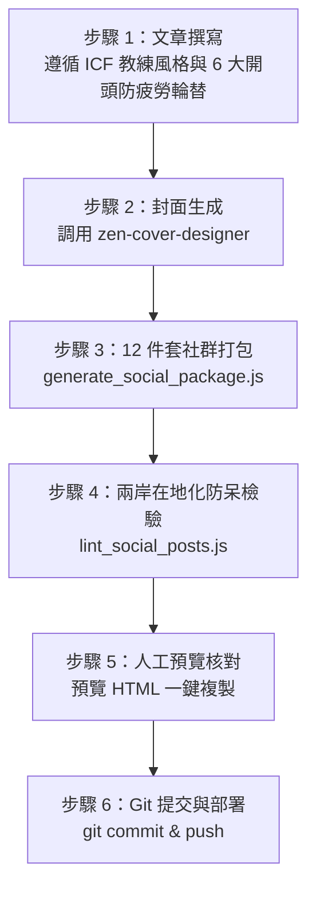

# 心茶記 文章撰寫與全自動社群分發管線 (Mind Tea Publishing Pipeline)

本技能為《心茶記》(Mind Tea Journal) 之核心出版發行管線，統籌「文章撰寫 $\rightarrow$ 封面生成 $\rightarrow$ 12 件套社群分發包產製 $\rightarrow$ 兩岸語彙防呆檢驗 $\rightarrow$ Git 版本控制與遠端部署」全流程。

---

## 🚀 完整出版發行六步走管線



---

### 步驟 1：文章撰寫規範 (`_posts/YYYY-MM-DD-<slug>.md`)

1. **ICF 專業教練精神（去說教鐵律）**：
   - 保持並肩探索的夥伴關係，堅決避免居高臨下的指導或指責。
   - 避免「你應該」、「你必須」，轉化為好奇提問與覺察邀請。
   - 貫穿四大基石：自我覺察、深層價值觀、正向空間、微行動。
2. **六大開頭模型輪替（嚴防審美疲勞）**：
   - **嚴格禁止**動輒使用公式化的「你有沒有過這樣的時刻？」、「你一定遇過這種情況：」。
   - 每篇新文章強制在 6 大模型中輪替：
     - **模型 1：現場微對話 / 留白切入**（以一段真實教練對話或寂靜留白開場）
     - **模型 2：畫面定格 / 感官白描切入**（如茶湯熱氣、窗外雨絲、桌面震動的手機）
     - **模型 3：反直覺觀點 / 認知翻轉切入**（挑戰常識，如「憤怒不是壞事」）
     - **模型 4：客觀現象白描 / 人類心智觀察**（如傳播學媒介豐度、大腦神經機制）
     - **模型 5：哲人思想 / 詩意隱喻切入**（如布伯「我與你」、地圖與疆域）
     - **模型 6：身心覺受 / 落地共振切入**（如緊繃的咬肌、懸在喉頭的呼吸）
3. **文章五步結構**：
   - 生活/教練現場切入 $\rightarrow$ 底層心理機制拆解 $\rightarrow$ 有力提問（留白） $\rightarrow$ 溫和微步實驗 $\rightarrow$ 溫潤金句收尾。
4. **Frontmatter 格式**：
   ```yaml
   ---
   layout: post
   title: "主標題：副標題"
   subtitle: "心茶記專欄精選"
   date: YYYY-MM-DD
   permalink: /post/<slug>/
   categories: [自我覺察, 溝通藝術]
   tags: [ICF教練, 傾聽, 心理安全]
   author: Sunny
   cover_image: assets/social/<slug>.jpg
   ---
   ```
5. **排版與思維模型呈現規範（全面停用流程圖與表格，改採純文字「茶禪思維對比卡」）**：
   - 🚫 **全面禁止使用 Mermaid 流程圖與 HTML 表格**：
     - **歷史痛點徹底杜絕**：
       - **不再有刺眼的黑白方框**：方格子與知乎編輯器在暗黑模式下會強制對 `<table>` 畫上刺眼的白色線框，嚴重破壞沉浸感。
       - **不再有長串無意義的空箭**：拒絕用垂直箭頭 `↓` 堆砌的過度設計，避免碎裂排版。
       - **徹底根除漏圖與螞蟻字**：第三方編輯器會主動過濾 Base64 行內圖片，流程圖轉縮圖在手機端字體極小無法辨識。
   - 🍵 **唯一標準規範：茶禪思維對比卡（純文字結構化 Markdown 引用卡）**：
     - 在文章正文與社群貼文中，凡需呈現心智框架、觀點對比或步驟推演時，**一律使用標準 Markdown 引用塊 `>` 結構化條列**。
     - **茶禪思維對比卡標準格式範式**：
       ```markdown
       > 🌲 **心智框架對比：[主題名稱]**
       >
       > ❌ **問題框架 / 舊慣性（[別名 · 原地糾纏]）**
       > ・思維焦點：[死盯障礙、抱怨反芻]
       > ・情緒狀態：[委屈、焦慮、內耗、精力枯竭]
       > ・實際結果：[停滯在原地與問題死磕，動能耗盡]
       >
       > 💡 **願景框架 / 破局微步（[別名 · 破局本能]）**
       > ・思維焦點：[牢牢鎖定目的地與解決方案]
       > ・情緒狀態：[冷靜、好奇、主動探索、身心敏銳]
       > ・實際結果：[靈活繞道與前行，把障礙降級為途經路況]
       ```
     - **核心優勢**：
       - **100% 純文字語意化**：暗黑模式與白天模式完美自適應，呈現溫潤鼠尾草綠茶席邊框。
       - **零依賴、零崩壞**：無任何圖片依賴、無表格外框、無跨平台相容性問題。
       - **一鍵複製、秒發布**：讀者與作者在手機及電腦端均享有極致舒適、雜誌級的清爽閱讀體驗。
6. **教練提問與反思卡片排版鐵律（嚴格禁止原生 HTML 標籤，防方格子大面積空白）**：
   - 🍵 **一律使用標準 Markdown 引用塊語法**（例如：`> 🌿 **心茶記 · 教練覺察提問：**` 與 `> 1. **...**`）。
   - 🚫 **嚴格禁止在 Markdown 內文直接書寫 `<div class="coaching-box">`、`<ol>` 等原生 HTML 標籤**。

---

### 步驟 2：生成禪意封面 (`zen-cover-designer`)

1. 調用 `image-generator` 子代理，輸入符合 [`zen-cover-designer`](../zen-cover-designer/SKILL.md) 規範之提示詞。
2. 圖片產出後，執行歸檔腳本：
   ```bash
   node .agents/skills/zen-cover-designer/scripts/archive_cover.js <來源圖片路徑> <postSlug> <targetSocialDirName>
   ```

---

### 步驟 3：全自動生成 13 項社群與短影音分發包

執行分發包產生器：
```bash
node .agents/skills/mindtea-publish/scripts/generate_social_package.js _posts/YYYY-MM-DD-<slug>.md
```

腳本會自動在 `social_posts/YYYY-MM-DD_主題名/` 中建立完整 13 項資產：
1. `01_Facebook.txt`（繁體，走心故事體）
2. `02_LinkedIn.txt`（繁體，自我領導力與職場心理安全）
3. `03_Threads.txt`（繁體，高密度短金句與大間距留白）
4. `04_方格子.md` 與 `04_方格子.txt`（**100% 繁體字 + 台灣在地語彙**，文末附作者簡介與雙 QR Code 指引）
5. `04_方格子_富文本預覽.html`（內建「一鍵複製富文本」按鈕，格式完美貼入編輯器）
6. `05_微信朋友圈與群.txt`（簡體，晨光問候與教練反思微問題）
7. `06_小紅書.txt`（簡體，痛點標題、條列 emoji 排版、**零外部連結**、心茶記搜尋指引）
8. `07_知乎.md` 與 `07_知乎.txt`（簡體深度專欄版）
9. `07_知乎_富文本預覽.html`（內建「一鍵複製富文本」按鈕）
10. `08_短視頻腳本.txt`（**30 秒短影音分鏡腳本**：五大風格模型輪替、分秒鏡頭、純旁白文字與 AI 畫面 Prompt）
11. `cover.jpg`（已由步驟 2 歸檔）

---

#### 🎬 30 秒短影音五大風格模型（防腳本審美疲勞）
依文章開頭與核心心理機制，自動輪替五大風格：
- **風格 1：教練現場微對話型**（沉浸偷聽感，以真實對談直擊心理防禦）
- **風格 2：身心覺察引導型**（30 秒數位冥想與 ASMR，引導身體落地）
- **風格 3：認知翻轉暴擊型**（打破常識的反直覺高能洞察）
- **風格 4：職場日常鏡像型**（生活與視訊會議困境還原，強烈共鳴）
- **風格 5：東方茶禪哲思型**（借茶器與自然物象抽離維度，溫潤金句相遇）

---

### 步驟 4：短影音自動渲染（全自動產出 9:16 高清 MP4）

若需將 30 秒腳本與封面合成為直式短影片，可執行：
```bash
node .agents/skills/mindtea-publish/scripts/render_short_video.js social_posts/YYYY-MM-DD_主題名
```

#### 🎙️ 短影音聲音與旁白鐵律（作者性別與教練設定）
1. **作者身份與男聲教練原則**：
   - 作者 Sunny 為**男性專業教練**，全站所有短影音旁白與語音輸出**嚴格限定為男性聲音**。
   - 堅決不使用女聲，嚴格禁止使用機械式無情感的傳統 SAPI（如舊版 Hanhan）。
2. **微軟神經自然語音標準參數**：
   - 指定模型：`zh-TW-YunJheNeural`（微軟自然神經語音 台灣男聲·雲哲）。
   - 語速調整：`--rate="-15%"`（放慢 15%，維持每秒約 2.8 字之呼吸留白節奏，避免急促說教）。
   - 音調調整：`--pitch="-5Hz"`（微降 5Hz，維持低沉、沉穩、溫潤且具心理安全感的陪伴氛圍）。
3. **五大分鏡與視覺反差鐵律（嚴禁單圖或相似圖到底）**：
   - 每支 30 秒短影音必須包含 5 組主體、構圖截然不同的視覺分鏡（`scene_1.jpg`~`scene_5.jpg`，結合茶席、深根古樹、工作桌、青松折射、雲海燭燈等多元教練隱喻），嚴格杜絕單圖到底或相似角度重複敷衍。
   - **自動補齊與無餓死串流**：若目錄缺少分鏡圖檔，`render_short_video.js` 自動由 `assets/default_scenes/` 補齊；所有輸入圖片強制循環超過音訊總時長（`dur + 10`），杜絕 FFmpeg xfade 轉場餓死與吞幀。
   - **平滑淡入淡出**：分鏡間統一採用 1.0 秒平滑 Crossfade（`xfade=transition=fade`）轉場。
4. **視覺與字幕排版**：
   - 格式：1080×1920 (9:16) 直式高清 MP4。
   - 視覺：滿版 9:16 沉浸視角搭配微對比度調校，消除黑邊。
   - 字幕：自動生成 ASS 樣式字幕，底部清晰大字卡搭配頂部品牌落款《心茶記 · 晨光微光 ｜ 30秒心智沈澱》。

---

### 步驟 5：發布前防呆檢驗 (Linter)

`generate_social_package.js` 會自動觸發 Linter，亦可單獨執行：
```bash
node .agents/skills/cross-strait-localization/scripts/lint_social_posts.js <目錄名稱>
```

**檢驗紅線**：
- ❌ 方格子嚴禁出現任何簡體字或大陸慣用詞（如「视频」、「屏幕」）。
- ❌ 小紅書嚴格禁止任何超連結（`http://`、`https://`、`.com`、`.io`）。
- ❌ 嚴禁出現臆測網域（如 `sunnycoach.com`）。

---

### 步驟 5：Git 提交與部署

確認 Linter 通過 `[PASS]` 後，提交至 GitHub 倉庫：
```bash
git add .
git commit -m "feat: publish <slug> and generate social package"
git push origin main
```

---

## 依賴與資源路徑

- 短影音全自動渲染器：[`scripts/render_short_video.js`](./scripts/render_short_video.js)
- 短影音分鏡腳本產生器：[`scripts/generate_video_script.js`](./scripts/generate_video_script.js)
- 分發包產生器：[`scripts/generate_social_package.js`](./scripts/generate_social_package.js)
- 富文本 HTML 產生器：[`scripts/render_rich_text_html.js`](./scripts/render_rich_text_html.js)
- 雙向在地化技能：[`cross-strait-localization`](../cross-strait-localization/SKILL.md)
- 封面設計技能：[`zen-cover-designer`](../zen-cover-designer/SKILL.md)
