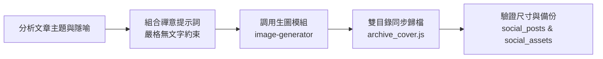

# 心茶記 禪意封面設計與雙目錄自動歸檔 (Zen Cover Designer)

本技能提供《心茶記》統一之視覺美學標準、提示詞工程範本，並自動執行圖片生成後的雙目錄歸檔作業。

---

## 工作流程



### 步驟 1：提示詞構思與主題隱喻配對
參閱 [`references/visual_prompts_guide.md`](./references/visual_prompts_guide.md)，確保畫面包含：
- **必備核心**：手作粗陶/汝窯茶器、溫暖琥珀茶湯與微小上升蒸氣、自然原木桌几、柔和晨光景深。
- **主題隱喻**：依據文章探討的心智模式（如情緒解離、認知差異、身體耗竭、心理防衛等），配對適當具象道具（如閉合信封、稜鏡、雨景、平靜水碗、老松盆景、玻璃蓋碗等）。
- **鐵律約束**：末尾必須包含 `ABSOLUTELY NO TEXT, NO LETTERS, NO WORDS, NO NUMBERS, NO WATERMARKS, NO TYPOGRAPHY.`。

### 步驟 2：調用生圖工具
調用 `image-generator` 子代理，給予符合規範之 Prompt。
子代理完成後將回傳生成圖片之本機實體路徑。

### 步驟 3：執行雙目錄自動同步歸檔
獲得圖片路徑後，執行內建歸檔腳本：

```bash
node .agents/skills/zen-cover-designer/scripts/archive_cover.js <來源圖片路徑> <postSlug> <targetSocialDirName>
```

**範例**：
```bash
node .agents/skills/zen-cover-designer/scripts/archive_cover.js \
  "C:/Users/s2332/.gemini/antigravity/brain/790f1df1-cdec-4a4c-8fdc-6b0d32b9c646/generated.jpg" \
  "physical-environment-and-communication-medium" \
  "2026-10-18_物理環境與溝通媒介"
```

腳本會自動同步寫入以下兩處：
1. `social_posts/YYYY-MM-DD_主題名/cover.jpg`（社群發布包）
2. `social_assets/<slug>.jpg`（部落格永久封面資產）

---

## 依賴與資源路徑

- 歸檔工具：[`scripts/archive_cover.js`](./scripts/archive_cover.js)
- 視覺美學規範與提示詞庫：[`references/visual_prompts_guide.md`](./references/visual_prompts_guide.md)
