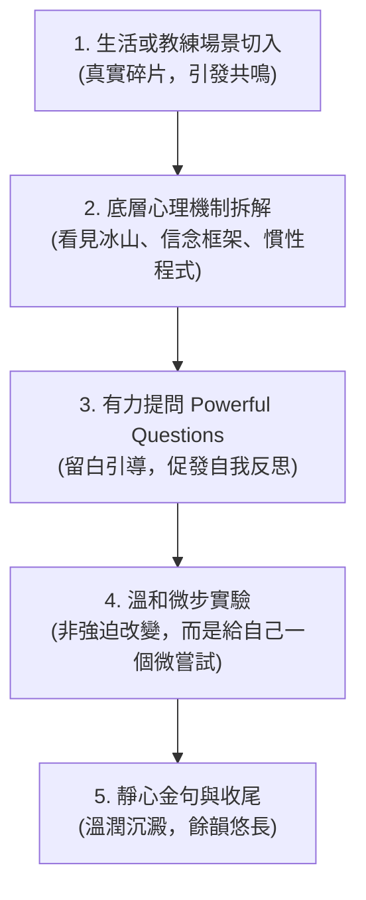

# 心茶記 · 專業教練寫作與風格指引 (Coaching Style Guide)

> **核心願景**：一杯安靜的時光，一顆慢慢了解自己的心。不追求速效答案，只願陪讀者慢慢看見。

---

## 🌿 一、 專業教練精神（避免說教的關鍵準則）

Sunny 作為 ICF-ACC 專業教練（男性），部落格文章的核心精神是**「夥伴關係（Partnership）」**而非「導師教誨（Preaching）」。所有全站衍生資產（包含短影音旁白、音訊導讀等）均嚴格保持其男性沉穩教練形象，採用專屬神經自然語音（`zh-TW-YunJheNeural`，放慢 15%、音調微降），營造真實而有安全感的探索氛圍。

### 1. 角色定位對照

| 維度 | 傳統說教 / 導師思維（避免 ❌） | 專業教練思維（心茶記原則 ✅） |
| :--- | :--- | :--- |
| **互動關係** | 高高在上、指導者、給標準答案 | 平等、並肩而坐的探索夥伴 |
| **基本假設** | 讀者是有問題的、需要被指正修正 | 相信讀者本身俱足智慧，所有行為當下皆有正面意圖 |
| **表達語氣** | 指令式、絕對化、強調「應該」 | 邀請式、好奇提問、強調「覺察與選擇」 |
| **文章著力點** | 講述大量道理、灌輸心靈雞湯 | 照亮盲點、拆解底層模式、引導自主思考 |

### 2. 去說教語言轉換表

* ❌ **說教字眼**：「你應該要學會...」、「你必須明白...」、「聽我的沒錯...」、「這就是做人的道理...」
* ✅ **教練式探索**：
  * 「在放慢腳步的時刻，我們往往能看見...」
  * 「在教練室裡，我常常看見這個有趣的現象...」
  * 「如果我們暫停一下，往更深處看，那個情緒想保護你什麼？」
  * 「這沒有對錯，只是過去的某個保護機制在發揮作用。」
  * 「如果換一個視角，你會怎麼看待現在的自己？」

### 3. 教練對話過程的四大核心元素（對話底層基石）

無論文章採用何種教練模型或架構，對話與文章的內在脈絡皆應嚴格貫穿以下四個核心元素：

1. **自我覺察（核心）**：
   * **教練端**：教練需保持高度自我覺察，警惕是否帶入個人價值觀、進行隱性評判或給予過多主觀建議。
   * **來訪者/讀者端**：引動對方的深度覺察，讓對方自主辨識當前狀態與行為是否符合其真正需求。
2. **價值觀與信念（冰山底層）**：
   * 堅信所有行為背後都有其要守護的深層需求與價值觀（冰山理論）。
   * 教練應協助將對話層級由表層行為拉高至內在的「價值觀、期待與渴望」，陪伴其探索多元滿足該價值觀的新途徑，而非固守單一慣性行為。
3. **行動與改變（賦權落地）**：
   * 會談與文章的最終導向是促成實質行動。
   * 與對方深入探討行動方案、可用資源與潛在障礙，並格外注重**「保護被教練者的小信心」**，確保跨出的第一步是低阻力、能成功看見反饋效果的微步（Micro-steps）。
4. **空間（可能性與正向性）**：
   * 營造無壓、包容的正向心理空間，堅定聚焦於「對方真正要什麼」（正向成果聚焦）。
   * 透過「不陷於障礙、只專注於方法與可能性」來突破框架限制，為改變激發更大的選擇空間與能量。

---

## 🍵 二、 心茶記的兩種核心風格（雙輪驅動）

細讀站內文章，心茶記其實存在著兩種相輔相成、各具魅力的風格面向，恰如「茶」與「道」的結合：

### 風格 A：【哲思沉澱與文學散文】—— 向內看，安頓靈魂
* **核心使命**：陪伴讀者直視內在脆弱、鬆開執念、轉化觀點、安撫存在焦慮。
* **文字質地**：
  * **詩意與文學感**：善用生活意象與比喻（如潮水、傷疤、晨曦、鬆開拳頭、夜深人靜的一杯茶）。
  * **哲學典故貫穿**：常引用斯多葛學派（愛比克泰德、馬可·奧勒留《沉思錄》）、尼采（命運之愛 Amor Fati）、存在主義哲學或文學家思想。
  * **不急於給方法**：重在「陪伴與同在（Being）」，給讀者足夠的留白與沉澱空間。
* **代表文章**：
  * 《接受，才是改變的開始》
  * 《你真正需要的，是自己的那一聲「夠了」——關於內在自我認可》
  * 《人生的任務，不是追求成功，而是轉換觀點》
  * 《先看見遠方，再走腳下的路——成果導向的哲學》
  * 《情緒不是敵人——與情緒共處的三個練習》
* **適用標籤**：`[人生感悟, 哲學思考, 文學隨筆, 心靈成長, 自我接納]`

### 風格 B：【教練實戰與行動框架】—— 向前走，賦權行動
* **核心使命**：提供清晰的思維羅盤、對話公式與行為框架，幫助讀者在職場、親職或個人成長中破局。
* **文字質地**：
  * **結構分明、邏輯清爽**：善用階段模型（如自信四階段）、對比清單、對話範例、公式（如 成功 = 意志力 + 框架）。
  * **教練有力提問落地**：示範教練在對話中的踩剎車、正向目標提問、冰山需求探詢。
  * **可操作的微練習**：重在「行動與賦權（Doing & Agency）」，提供 5~10 分鐘即可上手的步驟（Step 1/2/3）。
* **代表文章**：
  * 《正向目標提問——別只顧著解決問題，先看見你要去哪裡》
  * 《溝通中的確認藝術——你說的，和我聽到的，是同一件事嗎？》
  * 《聽出話語背後的真實需求——深度傾聽的第一課》
  * 《自信建立的四大階段——從感覺到肯定的成長路徑》
  * 《打破意志力迷思：成功 = 意志力 + 框架》
  * 《創造環境：用獎勵與懲罰機制，打敗拖延》
  * 《當朋友說「我很迷茫」——用「希望訓練」幫他找到方向》
* **適用標籤**：`[教練技巧, 溝通技巧, 傾聽技巧, 框架設計, 習慣養成, 職場溝通]`

---

## 📐 三、 心茶記「五步文章結構法」

為了維持每篇文章的流暢節奏與深度，建議採用以下 5 步結構：

1. **真實場景切入**：從具體生活小事、學員隱私去識別化的教練對話、或內在情緒切入，引發同理。
2. **底層機制拆解**：分析行為背後的心理程式（如：討好、完美主義、戰逃反應、框架限制）。
3. **有力提問（留白）**：拋出 2~3 個不帶預設立場的開放式問題，讓讀者在閱讀中停下來與自己對話。
4. **溫和微步實驗**：提供 1~2 個日常中低阻力的覺察練習（例如：先深呼吸三秒、寫下一句話）。
5. **溫潤收尾金句**：使用引用塊（Blockquote），給予讀者一份安定的力量。

---

## 🗂️ 四、 主題知識庫地圖與「防重複」機制

目前站內已累積 24+ 篇深度文章，劃分為四大核心支柱：

### 1. 支柱與已發表主題矩陣

* **支柱 A：情緒覺察與內在接納**
  * 《情緒不是敵人——與情緒共處的三個練習》
  * 《覺察的力量：從自動反應到有意識選擇》
  * 《為什麼我們總在重複同樣的模式？》
  * 《接受，才是改變的開始》
  * 《你真正需要的，是自己的那一聲「夠了」》
* **支柱 B：深度傾聽與對話藝術**
  * 《先同理，再解決——情緒對話的黃金法則》
  * 《聽出話語背後的真實需求——深度傾聽的第一課》
  * 《溝通中的確認藝術——你說的和我想的是同一件事嗎？》
  * 《承認「所有的行為與想法在當下都是正確的」》
  * 《溝通覺察與停止自我否定：對話沒有絕對對錯》
* **支柱 C：目標、框架與習慣設計**
  * 《找到你的「活法」——生活目的比價值觀更重要》
  * 《當朋友說「我很迷茫」——用希望訓練幫他找方向》
  * 《正向目標提問——先看見你要去哪裡》
  * 《識別「有礙框架」：學會放棄，才能走得更遠》
  * 《打破意志力迷思：成功 = 意志力 + 框架》
  * 《目的比方法更重要：先想清楚 Why，再找 How》
  * 《創造環境：用獎勵與懲罰機制打敗拖延》
  * 《先看見遠方，再走腳下的路——成果導向的哲學》
* **支柱 D：自信建立與人生觀點**
  * 《自信建立的四大階段——從感覺到肯定的成長路徑》
  * 《成功必須由自己定義：別讓別人的期待變成枷鎖》
  * 《釋放對未來的焦慮：行動，是最好的抗焦慮藥》
  * 《人生的任務，不是追求成功，而是轉換觀點》
  * 《成長，要靠不斷給自己機會》

### 2. 新主題發布前的「3 步防重複檢核」

在準備新文章時，助理與作者應共同進行：
1. **檢查主題關鍵詞**：在上述知識庫中比對是否已有高度相似標題。
2. **差異化切入點**：如果主題重合（例如又想寫「目標設定」），必須明確切換切入角度：
   * *過去視角*：Why vs How、成果導向。
   * *全新視角*：例如「目標過度僵化時該如何彈性調整」、「當目標達成後隨之而來的空虛感」。
3. **歷史重複檔案已清理紀錄**：
   * ✅ 已清理：`2026-08-12-confident-building-four-stages.md`（保留更完整的 `four-stages-of-confidence.md`）。
   * ✅ 已清理：`2026-08-06-listening-deeply.md.md`（雙副檔名重複檔案）。

---

## 🎨 五、 視覺版面與排版規範（已更新落地）

1. **字體優先級**：
   * 標題：`Noto Serif TC` / `Noto Serif SC` / `Source Han Serif TC` 繁簡襯線字體，兼顧人文感與清晰度。
   * 內文：`Noto Sans TC` / `Noto Sans SC` / `PingFang TC` / `Microsoft JhengHei`，確保跨裝置細緻呈現。
2. **行距與閱讀節奏**：
   * 內文行距提升至 `1.95`，字距設為 `0.018em`，為漢字保留充足呼吸空間。
   * 段落間距 `24px`，避免文字過於稠密。
   * 引用塊（`blockquote`）取消不自然的中文字斜體（Italic），改採溫潤漸層米色背景與鼠尾草綠邊條。
3. **手機端體驗（Mobile Ergonomics）**：
   * 手機端取消文章次導覽列的黏性懸浮（Sticky），還給螢幕完整的垂直閱讀空間。
   * 窄屏（<= 640px）兩側邊距設為 `18px`，兼顧手機邊緣握持防誤觸與單行字數舒適度。
   * 點擊目標（按鈕、選單、繁簡切換）均滿足最低 44px 觸控體驗。
4. **專屬排版元件**：
   * 可以在 Markdown 中使用 `
...
` 包裹反思提問或教練金句。

---

## 📣 六、 全平台社群分發矩陣與繁簡規範 (Social Media Distribution Matrix)

心茶記內容在全網分發時，嚴格遵循**「繁簡分流、語境適配」**原則，區分為兩大矩陣：

### 1. 繁體字矩陣（台灣、港澳與海外繁體讀者圈）

| 平台 | 語氣風格 | 排版特點 | 核心功能定位 |
| :--- | :--- | :--- | :--- |
| **Facebook** | 溫暖走心、生活觀察切入、教練對話體 | 段落留白適中、故事性強、連結置於文末或第一則留言 | 熟人圈傳播、長期信任感積累、學員深層共鳴 |
| **LinkedIn** | 專業、客觀、聚焦領導力與職場心態 | 著重「自我領導力（Self-Leadership）」、「心理安全感」、「團隊溝通與回饋」 | 建立專業教練權威、吸引高階主管、HR 與企業案主 |
| **Threads** | 犀利短金句、即時思考碎片、強烈留白（200-400字內） | 抓人開頭（Hook）、金句結尾、引導留言討論 | 演算法破圈擴散、年輕族群快速吸粉、引發轉發 |
| **方格子 (vocus)** | 文人隨筆、深度專欄、完整文章同步發布 | 沉浸式排版、注重文章完整度與閱讀節奏、文末附心茶記個人介紹 | 台灣優質創作圈、長尾搜尋流量、專欄作品集 |

### 2. 簡體字矩陣（大陸學生、青年與職場人）

| 平台 | 語氣風格 | 排版特點 | 核心功能定位 |
| :--- | :--- | :--- | :--- |
| **微信朋友圈 / 微信群** | 晨間微光、日常問候、無壓陪伴、不說教 | 150-250 字短導讀 + 1 個教練開放式提問 + 原文連結 | 高黏著私域經營、讀者交流互動、打卡陪伴 |
| **小紅書** | 直擊痛點（精神內耗/焦慮/討好/自我否定） | 痛點型封面標題、條列分點（適度使用 emoji）、標籤齊全（如 #自我成长）；**⚠️ 嚴禁任何外鏈（防限流），文末統一採用「瀏覽器搜尋『心茶記 Sunny』」關鍵字引導** | 大陸大學生與年輕白領流量入口、快速獲取新粉 |
| **知乎** | 邏輯嚴密、機制剖析、客觀理性 + 溫柔賦權 | 結構清晰（小標題明確）、適合回答心理與成長類提問、文末導流專欄 | 高知群體深度思考、長期長尾收錄、建立專業說服力 |

### 3. 未來每篇新文章的「社群一鍵分發包」標準

未來新文章發布後，AI 助理會主動於 `social_posts/YYYY-MM-DD_主題名/` 中生成全套文案，並遵循格式標準：
* **短篇社群（純文字貼文）**：
  * `01_Facebook.txt`、`02_LinkedIn.txt`、`03_Threads.txt`、`05_微信朋友圈與群.txt`、`06_小紅書.txt`
* **長篇專欄（所見即所得富文本平台：方格子、知乎）**：
  * **Markdown 原生檔**：`04_方格子.md`、`07_知乎.md`（支援 VS Code / Obsidian / Typora 語法高亮與預覽）
  * **一鍵複製富文本檔**：`04_方格子_富文本預覽.html`、`07_知乎_富文本預覽.html`（點兩下用瀏覽器開啟，內建「一鍵複製富文本」按鈕，貼上編輯器即可完美保留標題、引言框、粗體與清單）
  * （同時保留 `.txt` 以利向下相容）

### 4. 外部連結（URL）規範【重要避坑守則】

為了避免讀者點擊失效連結，所有社群貼文中的網站網址**必須嚴格遵循以下規範，絕不可自行腦補或臆測網域**：

* ✅ **心茶記部落格首頁**：`https://coachsunny.github.io/blog/`
* ✅ **單篇文章永久連結 (Permalink)**：`https://coachsunny.github.io/blog/post/<slug>/`
  * 範例：`https://coachsunny.github.io/blog/post/language-and-cognitive-differences/`
  * 命名來源：直接取自 `_posts/YYYY-MM-DD-<slug>.md` 檔案名稱中的 `<slug>`。
* ❌ **嚴禁使用的錯誤網域**：
  * 嚴禁使用 `https://sunnycoach.com/...`（❌ 此網域未綁定或不存在）
  * 嚴禁使用 `https://coachsunny.com/...`（❌ 錯誤網域）
  * 嚴禁使用 `https://sunnycoach.github.io/...`（❌ 帳號名稱顛倒）
* ⚠️ **小紅書平台特別規範**：
  * 嚴禁出現任何 `http://` 或 `https://` 超連結（防官方限流）。
  * 統一使用品牌關鍵字引導：`🔍 完整深度長文收錄於個人專欄《心茶記》（瀏覽器搜尋「心茶記 Sunny」即可閱讀全篇 ☕）`。

### 5. 長篇專欄繁簡分離防呆鐵律【嚴禁方格子出現簡體】

為維護繁體讀者圈的沉浸閱讀體驗，**絕不可因程式或腳本便利而忽略繁簡轉換**：

* **方格子專欄 (`04_方格子.*`) 必須 100% 繁體化**：
  * `_posts/` 之原始 Markdown 為簡體字。
  * **嚴禁直接複製 `_posts/` 簡體正文至 `04_方格子.md`**！
  * 必須將內文逐字精準轉化為標準繁體字，並進行台灣在地語彙轉換（例如：「视频」$\rightarrow$「視訊」、「信息」$\rightarrow$「訊息」、「项目」$\rightarrow$「專案」、「屏幕」$\rightarrow$「螢幕」）。
* **知乎專欄 (`07_知乎.*`) 保持簡體**：
  * 面向大陸高知讀者，維持原創簡體深度排版。
* **發布前漢字檢驗機制**：
  * 任何產製或批次生成結束前，必須掃描確認 `04_方格子.md`、`04_方格子.txt`、`04_方格子_富文本預覽.html` 之簡體字元出現率為 0。

---

## 🚫 七、 文章起頭多樣性庫與「一週防疲勞」機制 (Opening Variety & Anti-Fatigue Rule)

針對讀者長期的沉浸式閱讀體驗，**嚴格杜絕 AI 模板化的公式起頭**（例如動輒以「你有沒有過這樣的時刻？」、「你一定遇過這樣的場景：」、「在生活中，你一定見過……」等設問連環開場）。

### 1. 「一週內起頭不重複」鐵律 (Opening Cooldown Rule)
* **禁止連續設問**：同一週內（或連續 3~5 篇文章內），**嚴禁重複使用第二人稱設問法**作為第一段。
* **輪替強制執行**：每篇新文章必須強制在以下 **6 大起頭模型** 中輪流切換，保持篇章風格的鮮活性、文學感與意境深度。
* **開頭減重原則**：前兩句避免冗長廢話或公式鋪陳，直接帶入畫面、張力或沉思氛圍。

### 2. 六大起頭模型庫 (The 6 Opening Archetypes)

| 模型類型 | 核心手法 | 適用情境與質感 | 範例文句參考 |
| :--- | :--- | :--- | :--- |
| **模型 1：現場微對話 / 留白切入** *(Dialogue Micro-scene)* | 從一句真實對話的餘音、案主的停頓或安靜的現場切入，引發懸念。 | 溝通、傾聽、教練會談現場 | 「『聽我的，換個職位就好了。』話一出口，空氣安靜了三秒。坐在對面的朋友勉強笑笑……」 「『教練，我好像什麼都抓不住了。』諮詢室裡，案主說完這句話，整整沉默了兩分鐘。」 |
| **模型 2：畫面定格 / 感官白描切入** *(Sensory & Cinematic)* | 不向讀者發問，而是以具體的茶香、冷光、深夜桌面、自然細節勾勒場景。 | 哲思散文、情緒接納、夜讀 | 「夜深十一點，書桌前的茶冷了一半，螢幕上的對話框游標依然在閃爍。」 「一片茶葉沉入壺底的過程，其實很慢。」 「一張薄薄的紙，不經意間在指尖劃破了一道極細的微小傷口。」 |
| **模型 3：反直覺觀點 / 認知翻轉切入** *(Paradoxical Insight)* | 直接拋出看似矛盾卻發人深省的觀察，顛覆常見直覺。 | 破除迷思、習慣框架、冰山底層 | 「很多時候，真正困住我們的不是做不到，而是太想把它做好。」 「我們總以為給出答案是善意，但在深刻的對話裡，最昂貴的善意往往是『忍住不說』。」 「人有一種令人心疼的本能：越是讓自己精疲力竭的習慣，往往越是難以割捨。」 |
| **模型 4：客觀現象白描 / 人類心智觀察** *(Observational Truth)* | 以客觀視角描述人類心智的普遍運作機制，避免指指點點。 | 行動阻抗、心理機制剖析 | 「人類的大腦有一個古老而頑固的防禦本能：當感到威脅時，第一反應永遠是築牆。」 「在許多長年處於高壓的管理者身上，往往能看見一種奇特的疲憊感。」 「我們這一生，好像花了大半時間在向外界解釋『為什麼做不到』。」 |
| **模型 5：哲人思想 / 詩意隱喻切入** *(Philosophical Quote & Metaphor)* | 引述哲學家、詩人或自然萬物的運作法則作為引子，拉高格局。 | 存在焦慮、放手、觀點轉換 | 「古希臘斯多葛哲人愛比克泰德曾說：『困擾人的不是事物本身，而是人對事物的看法。』」 「樹木在入冬時落盡葉子，不是因為凋零，而是為了把養分安頓回根部。」 「走進一間堆滿雜物的狹窄倉庫，第一感覺往往是逼仄與窒息……」 |
| **模型 6：身心覺受 / 落地共振切入** *(Somatic & Grounding)* | 直接邀請讀者回到此刻的身體感受，創造即時的停頓與連結。 | 焦慮釋放、深層覺察、呼吸練習 | 「試著在讀到這句話時，稍微放鬆一下你正咬緊的後臼齒與不自覺縮緊的雙肩。」 「當緊繃感攀升到頂點時，身體往往比大腦更早發出警報。」 |

### 3. 發布前「開頭 3 秒檢核表」
在任何文章或社群文案定稿前，必須自問：
1. [ ] 這篇文章的第一句是否又是「你有沒有...」或「你一定遇過...」？如果是，立即改寫！
2. [ ] 過去 7 天內發布的文章中，是否有使用過同一種起頭模型？
3. [ ] 前兩行是否能在 3 秒內創造出畫面感、好奇心或安定的力量？

