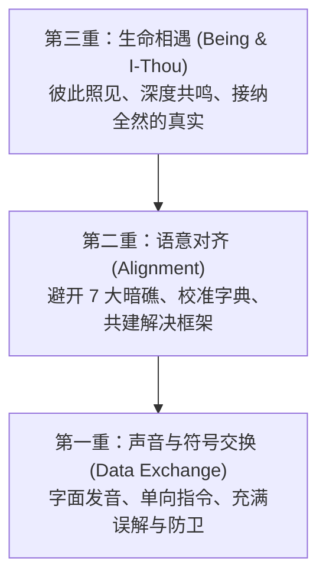

# 搭建清澈的对话之桥：在纷扰的世界里，找回彼此相遇的初心

> 【影响交流与讯息传递的 7 大关键因子 · 整合收官篇】

二十世纪伟大的存在主义哲学家马丁·布伯（Martin Buber）曾在《我与你》（I and Thou）中写下过一段震撼心灵的话：

> **「所有真实的人生，皆在相遇之中（All real living is meeting）。」**

在这段长达一周的连载旅程里，我们如同穿越一片布满暗礁与迷雾的深海，逐一打捞并检视了阻碍人类清澈交流的 **7 大沟通关键因子**：

1. **[语言与概念认知差异]({{ '/post/language-and-cognitive-differences/' | relative_url }})**：地图不等于疆域，走出字面的傲慢，读懂对方的私人字典；
2. **[物理环境与沟通媒介]({{ '/post/physical-environment-and-communication-medium/' | relative_url }})**：屏幕与距离悄悄滤掉了 70% 的微表情，为深度对谈铺上安定的物理地毯；
3. **[生理与心理情境]({{ '/post/physiological-and-psychological-state/' | relative_url }})**：在低血糖、疲惫与紧绷中开不出温柔的话，学会善待身体的能量红绿灯；
4. **[情绪色彩与语气]({{ '/post/emotional-tone-and-color/' | relative_url }})**：别把着火的信封砸向对方，穿透咆哮的波涛，打捞彼此真正的渴望；
5. **[信念与世界观／价值观]({{ '/post/beliefs-and-worldview/' | relative_url }})**：冰山水面下的暗礁主导了判断，看见偏狭背后的正向意图，欣赏森林的多样；
6. **[猜测与整体印象]({{ '/post/assumptions-and-labeling/' | relative_url }})**：摘下泛黄的旧标签眼镜，带着「初学者之心」重新看见眼前鲜活的生命；
7. **[防卫心理与自欺机制]({{ '/post/defensiveness-and-self-deception/' | relative_url }})**：卸下沉重冰冷的铠甲，率先松开紧握的拳头，以脆弱唤醒深层信任。

很多人在看完这 7 个因子后，常常会感叹：  
「Sunny，好好说一句话，原来有这么多的陷阱！我们究竟要如何才能在纷繁复杂的日常中，把它们融会贯通？」

今天，在这篇收官整合之作中，我们尝试提炼出一份极简的**「清澈对话心智罗盘」**。

---

## 一、 对话的三重境界：从信息传递，到生命相遇

如果我们将人与人之间的交流分层，大体可以看见三种截然不同的境界：

* **第一重：符号交换（我与它，I-It）**  
  我们把对方当成达成目标的工具、或者输入指令的代码。我们只在乎自己的话讲完了没有、事情办好了没有。这是绝大多数无效沟通与内耗争执的温床。
* **第二重：语意对齐（认知同频）**  
  我们开始拥有了对 7 大因子的觉察。我们注意到了环境的噪音、照顾到了对方的疲态、校准了词汇的刻度、避开了带刺的语气。沟通开始变得顺畅、高效而富有建设性。
* **第三重：生命相遇（我与你，I-Thou）**  
  在这一层，对话超越了胜负与说服。两个人并肩而坐，像在深山茶室里品尝一壶甘泉。我们不再强求对方认同自己的所有观点，但我们**深深看见了彼此作为一个独立生命的存在价值、脆弱与光芒**。

---

## 二、 ICF 教练四核心，如何贯穿 7 大沟通因子？

在专业教练（ICF）的体系中，我们不教套路，我们修炼的是内在心智的基石。你会发现，这 7 大因子的化解之道，恰好对应着教练对话的四大底层支柱：

### 1. 自我觉察（Self-Awareness）——照亮因子 3、4、7
在开口之前，觉察自己的身体电量（因子 3）、觉察喉咙里的语气是否有火（因子 4）、觉察自己是否正因为面子而启动自欺防御（因子 7）。  
**如实照见自己，是一切清澈沟通的起点。**

### 2. 价值观与信念（Core Values）——穿透因子 1、5
深信所有顽固的行为背后，都有一份想要守护的核心价值（因子 5）；明白每个人词汇背后的心智地图都由独特的经历所绘制（因子 1）。  
**不急着否定表面，而是耐心打捞深海里的宝藏。**

### 3. 正向空间与可能性（Space & Possibility）——化解因子 2、6
在物理环境里为彼此营造不被打扰的安全感（因子 2）；摘掉过去的刻板标签，给眼前的伙伴留出成长与改变的辽阔空间（因子 6）。  
**按下障碍的静音键，永远对生命抱持好奇。**

### 4. 保护小信心的行动（Empowering Action）——贯穿全过程
沟通的最终落点，不是讲出多么漂亮的大道理，而是促成彼此舒服的微小改变。多花 10 秒钟确认一句时间、在愤怒时深呼吸三次、主动给对方递上一杯水……  
**正是这一步步小到不可能失败的微行动，稳稳撑起了一座座信任之桥。**

---

## 三、 日常实践：清澈对话的「三秒入定公式」

在未来的每一天，当你即将走进一场重要的对谈、或者感到气氛开始僵持剑拔弩张时，不需要把所有的理论背一遍，只需在心底完成这**三秒钟的定锚**：

1. **第一秒，落回身体（Body）**：  
   松开咬紧的牙关，让肩膀沉下去，感受双脚稳稳踏在大地上。
2. **第二秒，校准意图（Intention）**：  
   在心里问自己：*「我此刻是想证明自己赢，还是真心想把事情做好、把关系维护好？」*
3. **第三秒，点亮好奇（Curiosity）**：  
   看着对方的眼睛，对自己说：*「他此刻的世界，正在经历什么？我很想听听看。」*

三秒钟的留白，足以让狂暴的杏仁核退位，让智慧与慈悲重新接管你的言语。

---

## 四、 晨光茶歇：茶烟渐散，心意澄明

古人说：「茶如人生，苦尽甘来。」

沟通又何尝不是如此？它绝非一条坦途，而是两个人带着各自的伤痕、习气与局限，在尘世的风雨中跌跌撞撞地摸索着靠近彼此的旅程。

> 7 大沟通因子的存在，不是为了让我们对人性感到绝望；  
> 而是像夜海航行中的七盏明灯，提醒我们避开暗礁，温柔地护送彼此抵达心灵的港湾。

感谢这一路陪伴《心茶记》走过这 7 篇连载的每一位读者。

愿往后的日子里，无论外界多么喧嚣嘈杂，你我都能在心底保留一处安静的茶席。  
开口有光，落座有温。  
慢慢说，慢慢听，慢慢看见。

---

*【影响交流与讯息传递的 7 大关键因子 · 连载圆满收官】*  
*感谢您的阅读与相伴。更多深度心智反思与教练随笔，敬请持续关注《心茶记》。*
