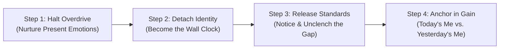

# You're Not Doing Too Little, You're Just Deducting Points with Perfectionism: How to Reclaim Self-Acknowledgement

If you ask someone who constantly wrestles with self-doubt and feels they are never "good enough":

> *"What did you accomplish today?"*

They will rarely recount the heart and energy they invested, nor the tasks they quietly completed. Instead, without hesitation—and usually laced with a tinge of self-reproach—they will recite their long list of **what was left undone**:

* *"I planned to finish three reports today, but I only managed one and a half."*
* *"I intended to go for an evening run, but I was exhausted from overtime and skipped it."*
* *"My delivery in today’s presentation still wasn't articulate enough; I messed up again."*

Inside the ICF coaching room, I frequently meet such deeply resilient, disciplined, and conscientious clients. To outsiders, their dedication and competence are unmistakable. Yet within their own hearts, they reside in a cold, solitary prison: **no matter how much they give or how far they travel, they feel inherently deficient, perpetually unable to tell themselves, "You did wonderfully."**

We often assume that an inability to acknowledge ourselves stems from a lack of self-discipline, inadequate talent, or simply not working hard enough.

Yet in cognitive psychology and through the lens of professional coaching, the reality is often the exact opposite:

**You are not doing too little. You have simply, unconsciously, installed a brutal "point-deduction system" inside your mind.**

---

## 1. The Cognitive Trap: Are You Held Hostage by "The Gap"?

In the study of human potential and growth mindset, psychologist Dr. Benjamin Hardy and strategic coach Dan Sullivan introduced an illuminating paradigm: **"The Gap" vs. "The Gain."**

Operating in **"The Gap"** means anchoring your yardstick of worth to an unreachable, idealized benchmark—the **"Ideal Standard"**:

* It might sound like: *"I must tick off every single item on my to-do list today."*
* Or: *"I should always remain emotionally unflappable, razor-sharp, and flawless."*
* Or: *"My peers are stepping into senior leadership; I must reach a certain milestone by year's end."*

When your eyes are perpetually fixated on that elusive 100-point ideal, your attention naturally zeroes in on **the chasm between your actual reality and that fantasy benchmark (The Gap)**.

Even if you gave your utmost and performed at 90 points today, any minor deviation or unfinished detail immediately triggers an internal alarm:

> *"Look at you—you fell short by 10 points! Why can't you get things right? You don't deserve to rest!"*

Under this point-deduction mindset, you exist in chronic emotional debt. In the presence of that phantom ideal, all genuine exertion feels trivial and cheapened. Because as long as a gap exists, your inner judge will never grant you permission to feel fulfilled.

Over time, your brain's neurochemical reward circuitry shuts down, replaced by a relentless tide of burnout, cynicism, and imposter syndrome.

---

## 2. The Essence of Self-Acknowledgement: Not Empty Praise, but Seeing Reality

Many hold a profound misconception about self-acknowledgement, assuming it means chanting hollow affirmations into the bathroom mirror or indulging in blind self-delusion.

True self-acknowledgement is none of that.

**Genuine self-acknowledgement is not arrogant self-deception; it is a courageous act of restoring objective truth to your lived reality.**

When someone cannot acknowledge themselves, their mind is suffering from acute **selective blindness**: it magnifies every limitation, error, and unfinished task while completely erasing the real sweat expended, the silent stress endured, and the courageous steps actually taken.

A coach’s primary purpose is not to hand you answers, but to help you gently set down the rigid measuring tape you use to whip yourself, redirecting your gaze from a fictitious horizon back to **the living ground taking root beneath your feet**.

---

## 3. Deep Coaching Inquiry: Three Questions When Spiraling into Self-Doubt

When your mind begins its familiar barrage of *"I'm useless"* and *"I failed again,"* resist the gravitational pull to plunge headlong into the spiral.

Slow your breath, grant yourself three seconds of intentional pause, and honestly sit with these coaching questions:

  
🍵 Mind Tea Journal · Deep Coaching Inquiry

  <ul style="margin: 0; padding-left: 20px; line-height: 1.8; color: #2c3e50;">
    <li><strong>Inquiry 1 (Exposing the Deduction System)</strong>: Is my present distress caused by actual inaction, or am I punishing myself against an impossible 100-point fantasy script?</li>
    <li><strong>Inquiry 2 (The Compassion Mirror)</strong>: If a dear friend did exactly what I accomplished today under the same pressure, would I coldly berate them as a failure, or would I embrace them and acknowledge how hard they tried?</li>
    <li><strong>Inquiry 3 (Re-anchoring in Reality)</strong>: If I temporarily set aside that distant finish line, how am I even slightly different or wiser today than I was yesterday?</li>
  </ul>

---

## 4. Grounded Practice: Coach Sunny's 4-Step Self-Acknowledgement Framework

When trapped in the quicksand of self-criticism and rumination, abstract philosophy alone is powerless.

You need an accessible, low-friction, immediately actionable **framework for psychological first aid**:

### Step 1: Halt the Overdrive — Nurture Present Emotional Safety
When self-reproach gallops like an untamed horse, rational logic cannot pierce through the noise.
* **Concrete Action**:
  * **Execute an immediate physical interrupter**: Step away from your workspace, close your laptop screen, and leave your chair.
  * **Engage sensory grounding**: Wash your face with warm water, brew a mindful cup of hot tea or water, and take three deliberate, unhurried belly breaths.
* **Coaching Core**: Self-acknowledgement requires emotional safety. Never repair a roof in the middle of a typhoon; allow your overheated nervous system to safely power down and cradle the part of you that feels vulnerable.

### Step 2: Detach Identity — Become the "Clock on the Wall"
In the thick of overwhelm, we fuse our temporary performance with our fundamental human worth (*"I didn't finish this task = I am fundamentally flawed"*), trapping ourselves in the defendant's dock of our own inner court.
* **Concrete Action**:
  * **Perspective-shifting practice**: Imagine dislodging from your contracted physical body and **becoming a quiet clock hanging high on the wall**.
  * A wall clock holds no prejudice, delivers no lectures, and enforces no arbitrary perfection. It simply observes the entire room with calm neutrality, gently gazing down upon the person sitting at the desk, furrowing their brow, doing their very best to navigate the moment.
* **Coaching Core**: When you observe yourself like a clock on the wall from a compassionate third-person perspective, you step out of the harsh judge's seat and become an empathetic, objective witness. You suddenly realize: *the person down there has actually done everything within their present capacity.*

### Step 3: Examine and Release the Phantom Standard
Ask yourself gently: *Who authored the "should" that is currently suffocating me?*
* **Concrete Action**:
  * Bring that exalted ideal into the light of awareness: *"Who mandated that I must operate at peak capacity today? Who demanded that I must be invulnerable?"*
  * Give yourself conscious permission: **"I acknowledge that an ideal standard exists, but today I grant myself permission not to reach it. Today, I am allowed to be imperfect."**
* **Coaching Core**: Notice the gap, but refuse to be defined by it. The moment you loosen your grip on perfection, the breathing room for authentic self-acknowledgement naturally opens.

### Step 4: Anchor in "The Gain" — Today's Me vs. Yesterday's Me
This is the pivotal cognitive recalibration: **shift your reference point from a distant ideal back to where you stood yesterday.**
* **Concrete Action**:
  * On a piece of paper or in your phone notes, write down: **"What did I gain or add today compared to yesterday?"**
  * Even if it feels microscopically subtle:
    * *"Yesterday when conflict arose, I shut down instantly. Today, I paused for five seconds before responding."*
    * *"Yesterday I procrastinated and wrote nothing. Today I only wrote 300 words, but those 300 words are a tangible gain."*
    * *"Yesterday I was consumed by guilt. Today, I had the awareness to pause and drink a cup of tea."*
* **Coaching Core**: Micro-progress is still progress. The moment you begin searching for **"The Gain,"** your mental circuitry transitions from a state of scarcity to one of abundance. Every gentle affirmation feeds your core confidence with authentic psychological nourishment.

---

## Closing Reflection: Welcoming the Self Who Gave Their All

At the tea table of *Mind Tea Journal*, seekers often ask me:

> *"Sunny, how accomplished must someone become before they can finally stop punishing themselves and feel proud of who they are?"*

I always slide a fresh cup of tea toward them and answer gently:

**Self-acknowledgement is never a golden trophy awaiting you at the mountain peak. It is the warm flask of tea you hand yourself the moment you lace up your shoes and take your first step into the mud.**

If you spend your life using the distant summit to mock the mud on your boots, you will forever live in servitude and scarcity.

Yet if, at the close of an exhausting day, you can look down at the soil on your shoes and say with heartfelt sincerity:

> *"I did not give up today. Compared to who I was yesterday, I took another small step forward. And that extra step is worthy of quiet honor."*

In that quiet second, the wind subsides. The mind settles.

You are no longer the frightened child fleeing from the whip of perfectionism. You have stepped into your own presence as a steadfast, compassionate guardian.

May you learn, in every ordinary day, to lay down the punishing ruler—and behold the steady, warm light that has been burning within you all along.

---

> **【Mind Tea Journal · Dawn Reflection】**  
> Ideals are meant to be distant stars that guide our direction,  
> Not whips used to scourge the ground we tread upon.  
> Cease tormenting your spirit with what remains unfinished;  
> Even if today brought only a single grain of new awareness,  
> You are already walking the sacred path of becoming yourself.  
> —— Coach Sunny
