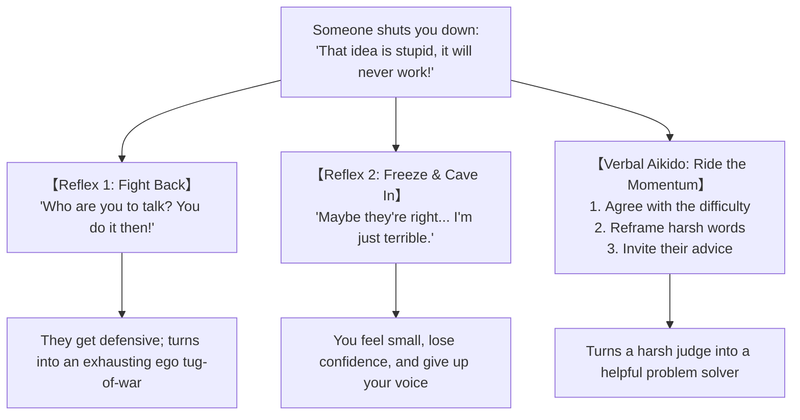
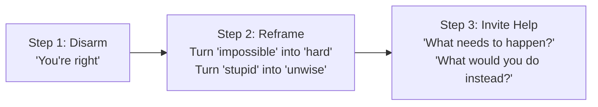

# Don't Fight Back Against Harsh Words: Use "Verbal Aikido" to Turn Dead Ends into Torchlights

*"That idea is completely stupid. It will never work."*

The air in the meeting room froze instantly. The other person tossed the proposal onto the table, leaned back in his chair, and looked across with cold, sharp eyes.

In a moment like that, most people feel their hearts race. Blood rushes to your head, and you either want to snap back: *"What do you know? You didn't even read the details!"* Or your chest tightens, you look down at your hands, and you swallow a bitter lump of shame, wondering if you really are as dumb as he said.

But in that very room, the coach didn't argue. He picked up his cup and took a quiet sip of warm tea.

He set the cup down, looked up gently, and spoke with calm warmth:

*"You're right. This plan definitely has a lot of hurdles. In your experience, what would need to happen for our chances to improve even just a little bit?"*

The critic's shoulders dropped slightly. He leaned forward onto the table, his guard slipping away: *"Well... if we really want to do this, we'd need better supply chain data first, and we'd have to rethink the budget."*

Just like that, the fight that was about to explode simply vanished. A cold judgment turned into a practical problem-solving talk.

In life and communication, this quiet skill is called **"Verbal Aikido."**

---

## 1. Why Arguing or Shutting Down Always Leads to a Dead End

When someone throws a harsh remark at us, our brains usually choose one of two reflexes: **Fight** or **Freeze**.

### 1. Fighting Back: Stepping Straight into Their Trap
When you shout back, *"No, it's not impossible!"*, you enter an ego tug-of-war. 
Psychology shows that when people attack or criticize bluntly, they are usually in a defensive state themselves, driven by fear of losing control. If you punch back, you confirm their hostility. Both sides hold on to their ropes tighter, and nothing gets done.

### 2. Shutting Down: Believing Their Rough Sketch
In an earlier article, we talked about [how our brains create stories around words](https://blog.portal-coachsunny.com/post/secondary-modeling-of-words/). Words are simple sounds; they can never capture the full truth.
When someone barks, *"You're being stupid,"* that is just a quick, cloudy reaction built from their own stress and limits. **It is not the truth about who you are, and it does not define your worth.** If you let it crush you, you are letting someone else's bad mood write your story.

---

## 2. The 3 Steps of Verbal Aikido: Turn Critics into Teammates

In the martial art of Aikido, you never block a punch head-on. You step aside, catch the attacker's energy, and guide it somewhere safe. 

In conversation, you can do this with three simple moves:

### Step 1: Agree First, So the Punch Hits Thin Air
* They say: *"This will never work in a million years!"*
* You reply: *"**You're right.** There are definitely major hurdles here."*

When someone throws a hard insult, they expect you to hit back. 
When you calmly say, *"You're right,"* their punch lands on soft cotton. There is nothing to push against. The tension disappears before it even starts.

### Step 2: Soften the Words (Reframing)
Notice how the words change:
* You change the dead-end word **"impossible"** into a real-world reality: **"a lot of hurdles."**
* You change the personal attack **"you are stupid"** into a practical point: **"the idea isn't wise yet."**

This is not giving up. It is emotional cleanup—wiping away the poison so you can focus on the real task.

### Step 3: Ask for Their Wisdom
* *"What would need to happen for our chances to improve even just a little bit?"*
* *"This idea definitely isn't the smartest. If you were in my shoes, what would make this actually work?"*

This is the magic move.
You take them down from the high judge's chair and hand them a seat at your work table. You don't try to prove them wrong. Instead, you use their critical eye to find the blind spots in your plan.

---

## 3. Coaching Questions to Ponder

When clients tell me they can't sleep because someone was harsh to them, I often invite them to take a slow breath by the tea table and ask two questions:

> **"When that harsh comment hurt you, what private fear inside yourself was it touching?"**

Often, criticism hurts the most when it echoes our own hidden doubts about not being good enough. We think we are angry at the other person, but deep down, we are frustrated with ourselves.

> **"If you didn't have to prove you were 100% right, what useful grain of truth in their cold water could save you from making a reckless mistake?"**

Real confidence doesn't mean having thick armor. It means having an open mind. When you are steady inside, harsh words cannot break you. They just become free risk-management advice.

---

## 4. A Small Experiment to Try (Micro-Action)

Next time someone throws a cold, critical remark your way, pause for **3 seconds**:

1. **Second 1: Feel your hands.** Rest your hands on your warm cup or the table. Feel the surface and let your breath slow down.
2. **Second 2: Remember the truth.** Tell yourself silently: *"Their mood belongs to them. It does not define me."*
3. **Second 3: Offer the Aikido response.** Speak with a calm, friendly tone:
   > *"You're right, there are some real obstacles here. In your experience, what would make this idea actually useful?"*

---

Harsh words usually come from someone's own fear of losing control.

**When you stop seeing criticism as a bullet, you can melt that bullet down and use it as a lantern to light your path forward.**
