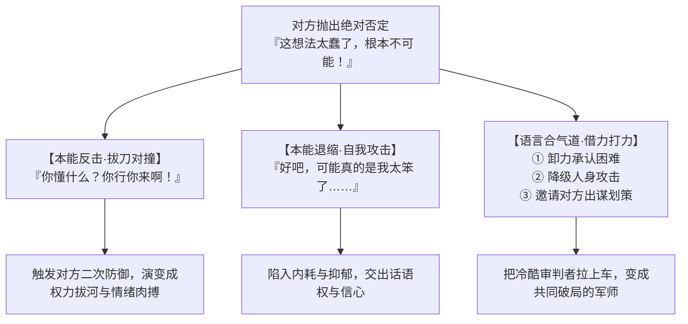
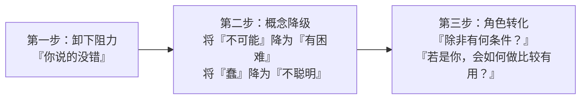

# 别对着刺耳的否定挥拳：用「语言合气道」把死局变成探路火把

「这个想法太蠢了，根本不可能落地。」

会议室的空气瞬间凝固了。对方把提案资料往桌上一扔，靠在椅背上，眼神里带着一丝冷淡与居高临下的挑剔。

换作以前，这样的场面足以让大部分人心率狂飙：血液直冲脑门，握紧拳头准备反唇相讥——「你懂什么？你连细节都没看凭什么否定？」；或者在胸口一阵闷堵后默默低下头，把满腹委屈与挫败咽进肚子里，暗自怀疑自己是不是真的不够好。

但那一刻，对桌的教练只是安静地端起茶杯，轻轻抿了一口温热的茶汤。

放下茶杯，抬起眼，语气平静而温和：

「你说的没错，这个想法确实有比较多的困难。以你的经验来看，除非有什么条件到位，成功的机会才能多出一点点？」

对方原本紧绷的肩膀微微一滞，靠在椅背上的身体不由自主地往前倾了倾，脸上的防备悄然松动：「……如果真的要推进，至少得先把供应链的数据补齐，而且预算分配得重切。」

你看，空气中那根原本一触即发的引线，在一瞬间消散了。冷冰冰的宣判，突然变成了具体的解题讨论。

这就是人际对谈中极具力量的修养——**「语言合气道」**。

---

## 一、 为什么反击与退缩，都会把对谈推进死胡同？

面对带刺的否定时，人类大脑的下意识反应通常只有两种：**战（反击）** 或 **逃（退缩）**。

### 1. 挥拳反驳：掉进对方的「防御模型」里肉搏
当我们急着反驳「哪有不可能！」时，我们潜意识里是在做「对错拔河」。
然而认知心理学告诉我们：**一个人在否定别人的时候，内心其实正处于一种「害怕失控或害怕被挑战」的封闭防御模型中。**
如果你挥拳打回去，恰好印证了他心中的敌意假设，逼得他调动全部能量来捍卫自己的面子。结果就是双方都死死拽着自己的绳子，事情完全停滞。

### 2. 委屈认栽：把对方的「粗糙建模」当成了真实自我
在之前的文章中我们曾探讨过[语言的「二次建模」机制](https://blog.portal-coachsunny.com/post/secondary-modeling-of-words/)：**语言只是低带宽的媒介，它根本无法完整复制真实的世界。**
当对方吐出「你太蠢了」时，那只是他受限于自身经验、焦虑或狭隘视野所渲染出来的一副粗糙滤镜，**那绝不是你的真实能力，更不是你的本质价值。**
如果你信了，你就等于用别人随手画出的简笔画，囚禁了自己辽阔的灵魂。

---

## 二、 语言合气道 3 步法：顺着力道，把审判台换成合作桌

合气道的精髓，在于「不迎面对撞，顺着对方的来力，引导其去往安全有益的方向」。在对话中，这套心法只需要极具智慧的三个微步：

### 步骤 1：主动作出接纳，让对方的重拳打在棉花上
* 对方发难：「这个想法根本不可能落地！」
* 你的回应：「**你说的没错**，这想法确实有比较多的困难。」

当一个人说出「不可能」时，他全身的神经都在戒备，等着你反驳。
当你坦然说出「你说的没错」时，等于他用尽全身力气挥出一记重拳，却一拳砸在了松软的棉花上。没有碰撞，没有对抗，对峙的张力瞬间被化解于无形。

### 步骤 2：不动声色的「概念降级」（Reframing）
仔细观察这里的词汇转换：
* 把绝望死结的**「不可能」** → 悄悄降级为客观现实的**「有比较多的困难」**。
* 把人身攻击的**「你太蠢」** → 降级为单纯策略层面的**「想法确实不够聪明」**。

这不是示弱，而是顶级的情绪排毒——**把带有攻击性的有毒标签，剥离成可以被理性讨论的事实状态。**

### 步骤 3：递出考卷，把「冷眼审判者」拉成「解题军师」
* 「你觉得**除非有什么条件到位**，成功的机会才能多出一点点？」
* 「这个想法确实不聪明，**如果是你，你会如何做让事情比较有用些？**」

这两句话是整个合气道最绝妙的收招。
它温柔而坚定地把对方从高高在上的「打分裁判席」，直接请到了必须挽起袖子的「解题工作台」。
你没有逼他认错，相反，你肯定了他的洞察力，并借用他犀利的挑剔眼光，来帮自己的方案排除盲区。

---

## 三、 ICF 教练的深度留白：我们是在捍卫自尊，还是在追寻成长？

在教练会谈中，每当来访者因为别人的刻薄否定而辗转难眠时，我常常会邀请他们一起在茶几旁做一段安静的呼吸，然后留下两个问题供彼此沉淀：

> **「当听到那句刺耳的否定时，你心底最害怕被对方说中的，究竟是什么？」**

很多时候，别人的否定之所以像一把尖刀，是因为它恰巧扎中了我们内心深处对自己最隐秘的怀疑。我们以为自己在生对方的气，其实是在生那个「似乎无法完美掌控一切的自己」的气。

> **「如果不需要证明自己永远是对的，那么在对方这盆冷水里，有没有哪一滴水，正好可以帮你浇熄盲目冲动的虚火？」**

最高段位的自信，从来不是刀枪不入，而是懂得**借力**。
当你的内心足够从容辽阔，这世上就没有什么攻击能真正伤到你；别人的挑剔，反倒成了你免费的风险评估师。

---

## 四、 守护小信心的微步实验（Micro-Action）

改变对话习惯不需要激烈的心理重组，只需要在下一次风暴来临时，启动一个**「3 秒暂停键」**：

1. **第 1 秒·手部落地**：双手捧住手边的茶杯、水杯，或用手指轻轻感受桌面温润的触感，让加速的心跳随着呼吸落回丹田。
2. **第 2 秒·还原事实**：在心里对自己说：「他只是在表达他的困难与焦虑，这不定义我。」
3. **第 3 秒·递出橄榄枝**：用最平和的语调吐出那句合气道真诀：
   > *「你说的没错，这里确实有很大的挑战。依照你的经验，你觉得要怎么做，事情才会稍微更有用一点？」*

---

带刺的语言，往往来自对失控的恐惧；而冰冷的否定，背后往往藏着未被看见的焦虑。

**当你不再把对方的否定当成子弹，你就能把那颗呼啸而来的子弹熔掉，铸成替自己照亮前路的探路火把。**
