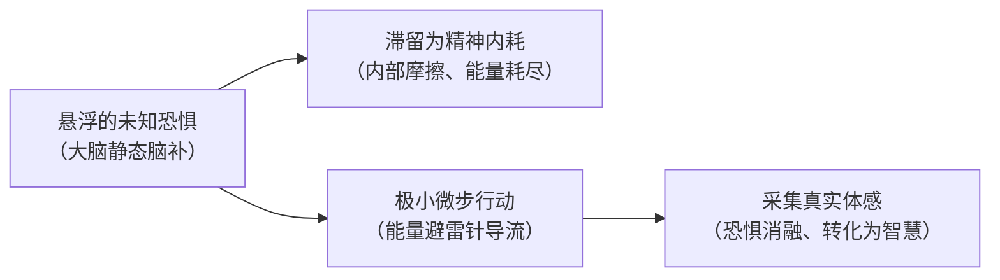
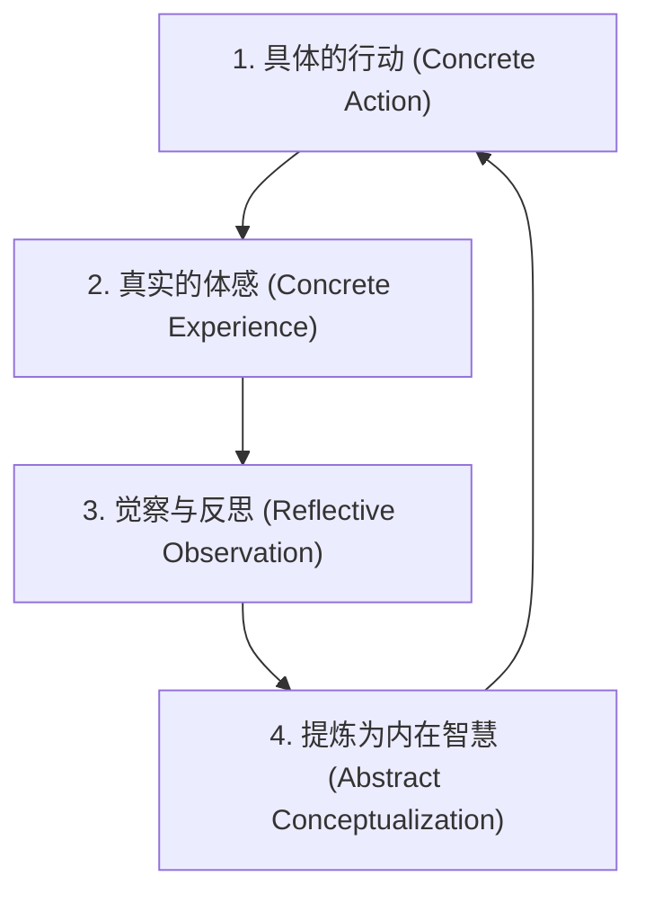

# 别在脑海里演灾难片：唯有行动，才能将恐惧转化为内在智慧

四周其实极其安静，没有任何枪炮声，也没有任何人当面斥责你。

但此时此刻，你的咬肌正紧紧地咬合着，双肩不知不觉耸到了耳边；胸口沉甸甸的，仿佛压着一块看不见的坚硬石头；呼吸浅浅地悬在喉头，每一次呼气都带着隐秘的颤抖。

你的大脑像一台失控的放映机，正在以最高帧率疯狂推演着未来的种种未知：下周那场棘手的跨部门谈判、迟迟不敢递出的转职申请、或是那个刚开始构思却仿佛注定会搞砸的新项目。在你的颅骨之内，一场场毁灭性的灾难片已经上映了无数轮。

你常常以为，自己只是在“严谨地未雨绸缪”、“做最坏的打算”。

然而身体早已诚实地拉响了红色警报：**你真正的能量，根本不是消耗在现实的挑战中，而是在这一场场无声的内部摩擦里，被提前耗得一滴不剩。**

---

## 一、 大脑的生存保护 Bug：你不是胆怯，你只是被古老的预测引擎劫持了

在教练对话中，我常遇到许多执行力极强的朋友，却在某个关键节点裹足不前、寝食难安。他们最常对我说的一句话是：“Sunny 教练，我明明知道该怎么做，可为什么心里就是那么害怕？”

每当这时，我都想先请他们把手放在胸口，深深地叹一口气。

请先明白：**你不是软弱，也不是执行力低下；你只是被人类进化了数百万年的生存机制“过度保护”了。**

人类的大脑并不是为了追求幸福或自我实现而设计的，它的底层核心指令只有一个：**活下去**。在远古丛林里，把风吹草动预设为猛兽出没的远祖活了下来；而那些生性乐观、觉得“应该没事吧”的祖先，大多基因早已断绝。

这种写在基因里的“负面偏好（Negativity Bias）”，让大脑在面对任何未知的未来时，本能地启动最极端的危机模拟：
* 只要是**未曾经历过的事**，大脑就会默认它充满了灭顶之灾；
* 只要是**没有绝对把握的结果**，大脑就会倾向于把所有的危险系数放大十倍。

大自然本意是想借由恐惧来保护你，然而在现代社会，这个保护机制却变成了最折磨人的 Bug：**我们在真实世界里毫发无伤，却在自己的脑海里，替尚未发生的未来提前服了无数次刑。**

---

## 二、 能量转换视角：焦虑，只是未被导流的“滞留能量”

物理学告诉我们，能量既不会凭空产生，也不会凭空消失，它只会从一种形式转化为另一种形式。

心理学与身体动力学也是同样的道理。**焦虑与恐惧，本质上并不是你的敌人，而是生命系统在侦测到潜在变动时，瞬间动员起来的高浓度生理能量。**

这股能量本身是中性的，关键在于它被导向了何处：

* **“只想不做”是静态内耗**：当你把这股强大的动能强行锁在颅骨内，试图通过一遍又一遍的胡思乱想来“消除不确定性”时，能量就无处宣泄，只能在体内激荡回流，转化为咬肌的紧绷、肠胃的绞痛与无休止的自我攻击。这就是心理学上的“内部摩擦力（Internal Friction）”。
* **“行动”是能量的避雷针与导流管**：唯有实际去“做”，才能为这股滞留的高压能量找到落地的出口。

你一定有过这样的经验：
> 一件拖了两个星期的报告，让你焦虑得整夜失眠、胃口全无；然而当你终于硬着头皮打开电脑，敲下第一段话的瞬间，原本胸口翻江倒海的恐慌，竟然奇迹般地平复了大半。

这不是奇迹，而是神经系统的客观规律：**一旦身体真正开始接触物理世界，大脑的注意力就会立刻从“虚构的假想敌”转移到“当下的具体任务”上。原本脑补的庞大怪兽，在真实的落地反馈面前，往往瞬间缩水成了一只无害的纸老虎。**

---

## 三、 闭合经验学习圈：没有真实体感，所有的道理都是二手租来的

二十世纪著名教育心理学家大卫·库伯（David Kolb）曾提出著名的**“经验学习圈（Experiential Learning Cycle）”**。他指出，一个人真正的心智成熟与认知蜕变，必须历经一个完整的四阶段闭环：

在这个认知闭环中，**“行动”是整座飞轮唯一的点火开关**。

* **没有行动，学习循环就彻底卡死**：如果你只在大脑里看书、听课、推演八百遍，你所拥有的仅仅是“租来的二手信息”，而不是属于你生命的“内在智慧”。
* **大象无法靠道理被说服**：心理学家乔纳森·海特在《象与骑象人》中形象地比喻，我们的理性思维是脆弱的骑象人，而潜意识与情绪神经系统则是一头庞大凶猛的大象。骑象人讲再多的道理，也无法消除大象对未知的恐惧。**要让大象安心，唯一的办法是牵着它往前迈出半步，让它的脚掌实实在在地踩在坚实的泥土上。**

当你迈出一步，身体采集到了真实的温度、质感与反馈，神经系统就会发出信号：“看，天没有塌下来，我们还活着。”

那一刻，原本盘踞在心头的恐惧，才会被真正消化、吸收，最终沉淀为你骨髓里的笃定与智慧。

---

## 四、 教练心法：把第一步“极致切小”，小到连大脑都懒得抵抗

既然行动是唯一的解药，为什么我们依然常常迈不出那一步？

因为很多人把“行动”定义得太沉重了。我们总以为，行动意味着“必须一战成名”、“必须拿出一套完美无瑕的商业计划书”、“必须彻底改变现状”。

当目标过于庞大时，你的杏仁核会立刻判定这是一场高风险的自杀行动，从而拉响全身的防空警报，让你瘫痪在原地。

在 ICF 专业教练现场，当案主面对未知裹足不前时，我们绝不会去逼迫他们咬牙死磕意志力，而是会温和地陪伴他们做一件事：**把第一步“切小、切小、再切小一点”，小到甚至连阻力都感觉不到。**

| 维度 | 演灾难片的内耗者 | 懂得落地的智慧管理者 |
| :--- | :--- | :--- |
| **行动定义** | 必须一战成功，必须完美搞定整件事 | 只为了向现实世界采集一小片体感 |
| **目标颗粒度** | 宏大而模糊（如：写完十万字专著） | 极度微小（如：只打开文档敲下标题） |
| **对待恐惧** | 试图等恐惧完全消失才敢动手 | 带着 10% 的微抖，先迈出 1% 的微步 |
| **神经机制** | 强刺激唤醒杏仁核，导致行为瘫痪 | 极低阻力绕过防御，直接激活行动神经 |

**行动的初衷，从来不是证明自己的伟大，而是让你的神经系统重新跟真实世界建立连接。**

---

## 五、 ICF 教练留白反思：给心智留出一杯茶的觉察

请暂时从紧绷的日程与无尽的脑补中抽离出来，端起手边的一杯温热茶汤，给自己的心智留白五分钟。

试着在心里静静地问自己这两个问题：

> 💡 **教练深度觉察提问**：
> 1. “那件让你的脑海推演了无数遍、迟迟不敢开始的事情，如果把它的第一步切小到‘就算闭着眼睛也不可能搞砸’的程度，那具体会是什么动作？”
> 2. “如果这一次的行动，目的完全不是为了‘证明自己很厉害或绝不失败’，而仅仅是像一个好奇的孩子一样，‘替自己的生命采集一小片真实的体感’，你的脚步会不会立刻轻盈一点？”

留白三秒。不必急着寻找标准答案，只要把目光投向那片空间，你的身体自然会慢慢松弛下来。

---

## 六、 落地微步实验：极致切小 3 分钟“体感采集法”

为了保护你宝贵的小信心，今天绝不需要做任何轰轰烈烈的大动作。请试着在今天完成这个零负担的微步实验：

1. **第一步【降载（Unload）】**：
   * 找到那个让你内心最焦虑的待办事项。把它的目标直接“砍到原本的 1%”。
   * 如果是写一篇长文，今天的目标不是完稿，而是“只写下前两句话”；如果是整理凌乱的房间，今天的目标不是全屋大扫除，而是“只把桌上的茶杯洗干净”。
2. **第二步【点火（Ignite）】**：
   * 设定一个倒计时，只做 **3 分钟**。
   * 在这 3 分钟里，不求质量、不作评判。穿上跑鞋走到门口、打开空白文档打上名字、或是拨通电话的前 30 秒问候。时间一到，如果你想停下来，可以心安理得地立刻停止。
3. **第三步【体感确认（Verify）】**：
   * 停下来后，闭上眼睛，深深地吸一口气，观察身体的细微变化：
   * 你的咬肌是不是松开了一点？胸口的那块大石头是不是变轻了？在心里对自己轻轻说一句：**“你看，我迈出去了，而灾难并没有发生。”**

---

> **焦虑是悬浮在半空的迷雾，而行动是踩在泥土里的脚步。**  
> **别在脑海里替尚未发生的未来服刑；当你迈出哪怕最微小的一步，恐惧就会在落地的瞬间，化作替你指引方向的内在智慧。**
