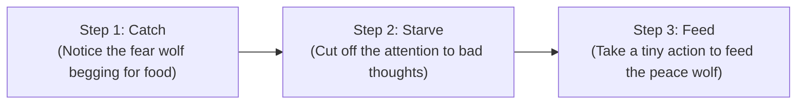

# The Real Secret to Self-Management: It's Not About Filling Your Calendar, It's About Which Wolf You Feed

Dr. Wayne Dyer, a well-known psychologist and teacher, often shared an old Cherokee story about life:

An old grandfather sat by a campfire with his young grandson.

The grandfather said softly:

> *"A fight is going on inside me. It is a terrible fight between two wolves.*  
> 
> *One wolf is dark. It is full of anger, fear, greed, self-pity, guilt, and blame.*  
> 
> *The other wolf is light. It is full of joy, peace, love, hope, kindness, and gratitude."*

The young boy listened closely, thought about it for a minute, and asked:

*"Grandfather, which wolf will win?"*

The old man smiled gently into the fire and answered:

**"The one you feed."**

---

In our busy modern lives, we often confuse self-management with punishing ourselves:

* We pack our calendars from early morning to late night, afraid to take a breath;
* We force ourselves with pure willpower to stay calm and never make a mistake;
* When someone doesn't agree with us, we get irritated and try to control their behavior.

Yet the result is almost always the same: **the fuller your schedule is, the more drained your mind feels.**

In my coaching sessions, I often see talented, hardworking people looking deeply tired. I like to ask them:

*"You spend so much energy managing your time and dealing with others. But have you stopped to check—which wolf inside you is eating up your energy right now?"*

Real self-management is not about fighting the clock. And it is certainly not about trying to change other people.

It is about **managing your inner energy and being careful about what you feed your mind.**

---

## 1. Step Back to Your Own Side of the Court

The biggest reason we burn out is a simple mistake: **we think managing ourselves means managing everything around us.**

* When a coworker doesn't do what you hoped, you spend the whole night feeling annoyed;
* When someone says something thoughtless, your mind replays it over and over;
* When plans change suddenly, you feel like the whole world is against you.

Ancient thinkers and modern coaching teach us one golden rule:

> **In this world, you cannot control other people or outside events. The only thing you can truly control is your own inner reaction.**

Trying to change others is the biggest energy drain in life. When you get angry, lecture someone, or try to force them to change, you are plugging your mind into a black hole. One bad mood from someone else can ruin your entire day.

**The first step in self-management is to step back to your own side of the court.**

Let other people handle their own lives. Let the world have its rainy days. Focus only on how you respond. When you stop wasting energy on things you cannot control, your real power comes back to you.

---

## 2. Shift from Time Management to Energy Management

Time is fixed. No matter what you do, everyone gets only 24 hours a day.

But **energy** is flexible.

When your energy is low, even if you have eight free hours, you end up staring blankly at your screen, procrastinating, and feeling guilty. But when your mind is calm and your energy is high, even thirty minutes of clear focus can create amazing work.

That is why wise people don't obsess over cramming every minute. Instead, they protect their **inner battery**:

| Topic | The Time Chaser | The Energy Manager |
| :--- | :--- | :--- |
| **Main Focus** | "Did I check off all my tasks?" | "How much energy does my battery have?" |
| **Handling Problems** | Sees a setback as a personal failure | Sees a setback as neutral feedback |
| **Other People's Moods** | Gets pulled into everyone's negativity | Keeps a calm boundary to protect their own peace |
| **Taking a Break** | Feels guilty for resting, doom-scrolls on the phone | Treats rest as a healthy recharge to reset their energy |

People who seem calm and productive are not ten times stronger than you. They just know how to protect their inner battery before the storm drains them completely.

---

## 3. The Two Wolves: Your Attention Is the Food

Let's return to the story of the two wolves:

Both wolves live inside every one of us:
* One is the **Fear Wolf**: whenever you are tired, it barks—*"What if you fail?"*, *"Everyone is judging you"*, *"You're not good enough"*;
* The other is the **Peace Wolf**: it sits quietly in the morning light, reminding you—*"This challenge will pass"*, *"You have made it through hard days before"*, *"Right now, you have a choice"*.

You cannot kill the dark wolf by fighting it. In human psychology, whatever you push against with force will only push back harder.

The only way to win is through your **attention**.

> **Your attention is food. Whatever you look at grows. Whatever you think about is what you feed.**

When you keep replaying a rude comment in your head, you are serving a big feast to the wolf of anger and fear.  
But when you take a deep breath and bring your attention back to your work, your family, or a warm cup of tea, you cut off the dark wolf's food supply and feed the wolf of trust and peace instead.

---

## 4. Two Coaching Questions in the Middle of Stress

When anxiety or irritation starts to rise, don't rush to fight it, and don't judge yourself for feeling it.

Pause for two seconds and ask yourself these two questions:

  
🍵 Mind Tea Journal · Coaching Inquiry

  <ul style="margin: 0; padding-left: 20px; line-height: 1.8; color: #2c3e50;">
    <li><strong>Question 1 (Notice the feeding)</strong>: Right now, when I feel annoyed by this problem or this person's attitude, which wolf am I tossing food to?</li>
    <li><strong>Question 2 (Stay on your court)</strong>: If I stop trying to change this person or this situation right now, what is one small thing I can do to recharge my own battery?</li>
  </ul>

---

## 5. The 3-Step Practice: Catch, Starve, Feed

Real self-management doesn't require giant speeches. It only needs you to shift your attention at key moments during the day:

### Step 1: Catch — Notice Your Body's Alarm
When the negative wolf wants attention, your body knows before your brain does:
* **What to notice**: Is your jaw clenched? Are your shoulders raised high? Is your breathing shallow and fast?
* **Mental shift**: Say to yourself gently: *"Ah, I see it. The fear wolf is hungry right now, and it's banging its bowl for food."* Notice it, but don't follow it.

### Step 2: Starve — Pause and Cut Off the Food
* **What to do**: Take a physical break. Close your laptop, stand up from your chair, look out the window, or wash your face with cool water. Tell your mind: *"Pause."* Refuse to keep arguing in your head.
* **Mental shift**: Don't fight the wolf; just don't give it any food. Most emotional waves naturally pass within 90 seconds if you stop feeding them with repetitive thoughts.

### Step 3: Feed — Do One Tiny Positive Action
* **What to do**: Move your attention to a small, gentle action that is completely under your control:
  * Pour yourself a warm cup of tea and enjoy the scent;
  * Take three slow, deep belly breaths;
  * Pick one simple task on your desk that takes two minutes, and finish it calmly.
* **Mental shift**: Every small action you take feeds the wolf of love and hope. As your good wolf grows stronger, outside noise will no longer shake your inner peace.

---

## Closing Thoughts: Guard Your Inner Fire

At the tea table of *Mind Tea Journal*, when friends tell me they feel out of control and tired of managing life, I like to pour them a fresh cup of warm tea.

Self-management is not about building stone walls to fight the world. It is like guarding a small, warm campfire on a cold, windy night.

The wind will blow, and rain will fall. Life will always have unexpected challenges.

Yet no matter what happens outside, you always hold the final choice: **will you put your firewood onto the warm, bright fire, or will you throw it into the cold dark pit?**

The highest level of self-management is not guarding against the outside world. It is looking after your own heart with kindness.

> **Whatever you focus on grows. Whichever wolf you feed is the one you become.**

May you learn, in every noisy day, to bring your hands back to your own space, and quietly feed the wolf of hope, strength, and peace within you.

---

> **【Mind Tea Journal · Dawn Thought】**  
> A calendar is just the bones of your day;  
> A peaceful mind is the life inside it.  
> Stop wearing yourself out on someone else's court.  
> Come back to your own cup of tea.  
> When you stop feeding fear,  
> The peace you guard will light the way ahead.  
> —— Coach Sunny
