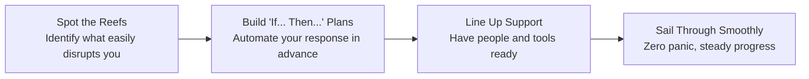

# When You Say "I'll Give It a Try," You're Already Planning to Quit: 3 Anchors to Make Real Change Happen (Part 1)

"Sunny, I think I want to *give it a try* and wake up an hour earlier every day to read."

My client sat across from me at the low tea table, holding a warm cup of tea with both hands. His eyes drifted slightly, showing a glimmer of hope, but also a hesitation he couldn't hide.

I didn't jump in with advice. I simply lifted my cup and let the steam rise softly between us. After a quiet three-second pause, I looked into his eyes and asked gently:

"When you tell yourself you're just going to 'give it a try,' does that mean your mind has already quietly left the backdoor open—so you can walk away whenever it gets hard?"

He froze for a second. His shoulders dropped, and his breathing slowed down. A moment later, he gave a quiet smile: "You caught me. Every time I say 'I'll try,' deep down I'm thinking, *'Well, if it doesn't work out, it's not a real failure because I only said I'd try.'*"

We see this everywhere in life and work. We want to switch careers, work out regularly, fix a strained relationship, or stop procrastinating. Yet, our very first step is almost always that polite, hesitant phrase: "Let me just give it a try."

In professional coaching and psychology, **saying "I'll try" isn't being humble—it's a clever defense mechanism.** When your focus at the starting line is already about how to exit gracefully, the ship has basically agreed to sink before it even leaves the dock.

If you want changes that truly last, you need to flip three essential switches right at the start.

---

## Anchor 1: Ownership and Commitment—Moving from Problems to Vision

Why is the success rate of "giving it a try" so painfully low?

When you approach a change with a trial mindset, your inner commitment usually sits at only a 3 or 4 out of 10. Without strong inner roots, the moment life pushes back—a freezing morning, an exhausting workday—your brain happily triggers that escape clause: *"See? I told you it was too hard."*

Even worse, every time we quit halfway, it reinforces a quiet, painful belief: *"I'm just someone who lacks willpower."* That slowly chips away at your self-confidence.

In professional coaching, we don't dwell on past excuses or ask, "Why couldn't you do it before?" **Digging endlessly into past failures only keeps your brain trapped in guilt and defense.**

Instead, we shift to a forward-looking **Solution Focus**:

```mermaid
flowchart TD
    subgraph DefeatPath["⚠️ The 'Try' Trap (The Escape Loop)"]
        A1["Vague Wish: I'll give it a try"] --> A2["Low Commitment (Backdoor left open)"]
        A2 --> A3["First Small Obstacle Appears"]
        A3 --> A4["Trigger Excuse: Well, I only said I'd try"]
        A4 --> A5["Give Up & Feel Defeated"]
    end
    subgraph SuccessPath["💡 The Ownership Path (The Growth Loop)"]
        B1["Clear Vision: What I truly desire"] --> B2["100% Inner Ownership"]
        B2 --> B3["Expect Obstacles & Prep Plans"]
        B3 --> B4["Navigate Through Storms Calmly"]
        B4 --> B5["Confidence Grows & Builds Momentum"]
    end
```

We ask clear, inspiring questions instead:
* "If this change actually happens, what sweet rewards and real freedom will it bring to your daily life?"
* "Picture yourself a year from now, living comfortably with this new habit. What does that bright, energized life look like?"

**Real self-discipline isn't about grinding your teeth; it's about being pulled forward by a clear and beautiful vision.** When you truly see that future, you willingly give up the excuses and take full ownership of the steering wheel.

---

## Anchor 2: Taking Back Control of Your Time—Set Your Own Pace

The second trap people fall into is having unrealistic expectations about time.

This usually shows up in two extremes:
1. **The Endless Marathon**: Setting a huge, distant goal that drags on so long you lose all excitement, getting swallowed by everyday distractions.
2. **The Overnight Miracle**: Secretly hoping that starting today will fix everything by tomorrow. When day three doesn't bring magic, disappointment takes over.

When people see this, friends or managers often try to help by saying: "Just do 20 minutes a day," or "Try it for 30 days first."

**In professional ICF coaching, handing out unsolicited advice is a major mistake.**

Giving people ready-made answers might feel helpful, but underneath, it sends a quiet message: *"I don't trust you to manage your own life, so do it my way."* That instantly kills their sense of ownership and autonomy.

| Dimension | Following Advice (Passive) | Owning Your Pace (Coaching) |
| :--- | :--- | :--- |
| **Driving Force** | External pressure; easy to resist | Pure inner awareness; proud to own it |
| **Timeline** | Copying someone else's schedule | Built around your real life and energy |
| **When Facing Snags** | Blaming others: "Your method didn't work" | Seeing data: "I chose this, so I can tweak it" |
| **Long-term Value** | Fades quickly once oversight stops | Becomes a permanent inner asset |

A grounded coach always puts the pace back into the traveler's hands:
> "If we break this big dream into one solid, gentle first step, how much time feels right to you—so you feel genuine progress without feeling overwhelmed?"

When you choose your own speed, you stop complaining about the voyage. You know every knot of wind is guided by your own hands.

---

## Anchor 3: Preparing for Obstacles—Packing Life Jackets on Sunny Days

Action-oriented people are often the fastest to set sail, but also the quickest to capsize.

In the excitement of starting, they only see the golden sunrise and calm waters, completely ignoring hidden reefs. When a sudden wave hits, panic takes over, and everything falls apart.

Talking about potential difficulties isn't negative thinking—**it's packing life jackets and checking the ropes while you're still safely in the harbor.**

Storms happen at sea; that's just nature, not proof that you're a bad captain. What matters is whether you saw the storm coming and prepared a simple game plan:

For instance, instead of making a dramatic vow like "I will never stay up late again," ask yourself calmly:
* "If I have to work late next week and feel completely drained, what is one tiny, gentle ritual I can do instead so I don't lose my momentum?"
* "When that quiet voice whispers 'let's skip it today,' who is one person I can reach out to who will hold space for me?"

**True inner strength doesn't pretend reefs don't exist. It means knowing the reefs are there, and sailing forward calmly because you brought good maps and trusted tools.**

---

> 🌿 **Mind Tea Journal · Coaching Inquiries:**
>
> 1. **The Captain's View**: In the change you want to make, are you the only true captain of this ship, or are you just a passenger holding a ticket, ready to jump off at the first bumpy wave?
> 2. **Storm Prep**: If there is definitely a storm waiting on your route ahead, what is the warm raincoat you can prepare for yourself right now?

---

## 🍵 A Gentle Micro-Experiment: Your 3-Question Pre-Flight Checklist

Lasting change doesn't need dramatic vows. It only takes a quiet cup of tea, a sheet of paper, and three honest answers:

* **Step 1: Check Your Ownership (Commitment)**:
  Write down your goal and rate your inner desire from 1 to 10. Ask: *"How much do I truly own this?"* If it's below an 8, don't rush into action. Pause and reconnect with your vision until you find the reason that truly lights a fire inside you.
* **Step 2: Reclaim Your Timeline (Time)**:
  Forget online templates and advice from others. Write down: *"What is the most grounded, comfortable timeline for my first phase, given my real energy and life right now?"*
* **Step 3: Pack Your Life Jacket (Difficulty)**:
  Name the single biggest distraction or obstacle likely to pop up in the next two weeks. Create a simple **"If... Then..."** formula for it (e.g., *"If work runs past 10 PM, then I will simply take 3 deep breaths and write down one sentence before bed, and count today as a win."*).

---

> Change never comes from desperate, all-or-nothing drama; it comes from calm, steady navigation.
> 
> When you stop leaving your life to chance, hidden reefs aren't the end of your journey—they are where you truly learn how to steer your ship.
> 
> *(This is Part 1 of our two-part series on Commitment to Change. Part 2, exploring how to dissolve inner resistance and rewire your framework, will arrive soon. Stay tuned over tea.)*
