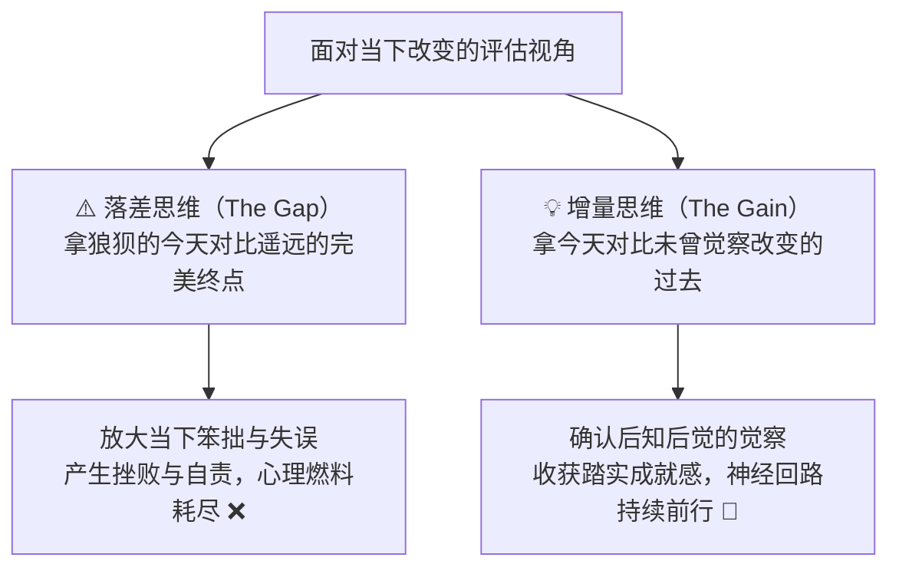
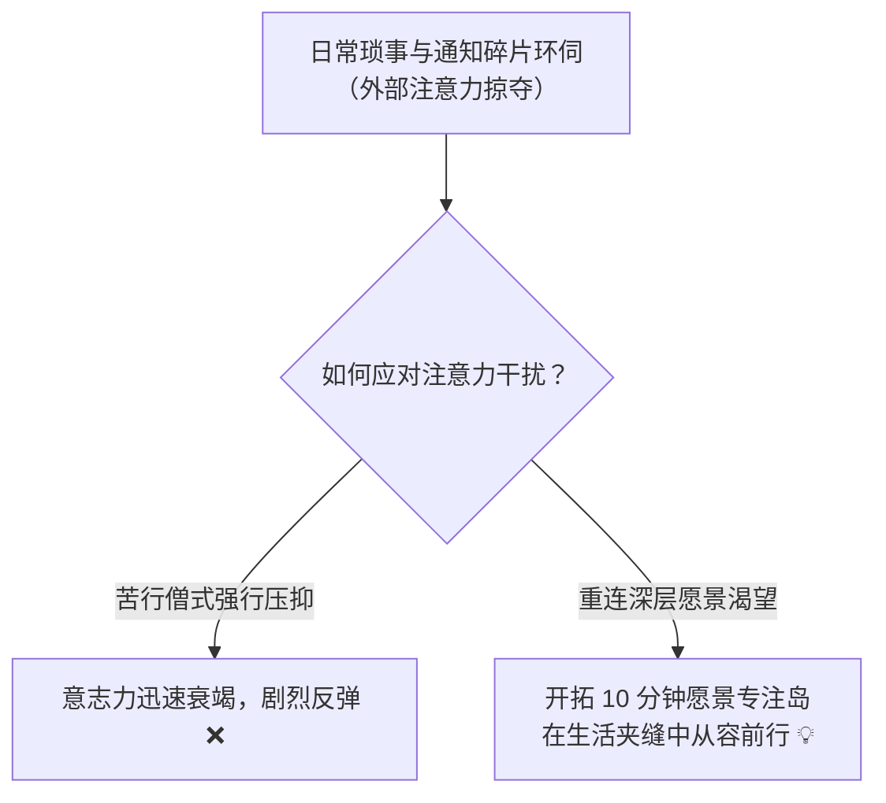
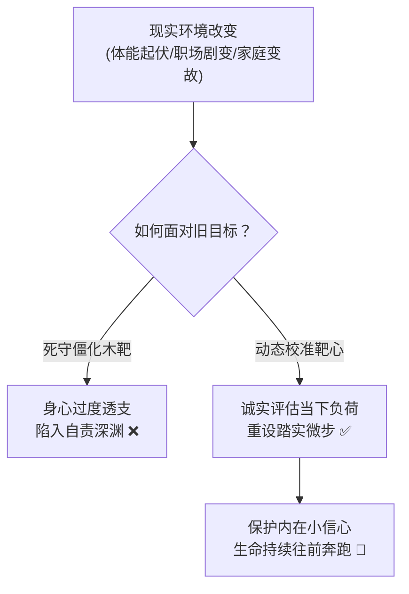

# 换掉做不到的目标，不叫半途而废：谈承诺改变的燃料补给与动态维持（下篇）

在许多人的潜意识里，自律的最高标准是“咬紧牙关、死守承诺、寸步不让”。

一旦中途进度落后，或是发现既定目标脱离了现实生活而不得不调整时，内心便会涌起巨大的罪恶感与羞愧，痛骂自己又是一个“缺乏毅力、半途而废的失败者”。

但在专业教练的视野里，真相恰恰相反——

**死守一个已经不合时宜的旧目标，不叫责任感，那叫心智僵化与自我折磨。**

真正的“维持（Maintenance）”，维持的从来不是一块僵死的木头靶子，而是生命持续往前奔跑的温度与动能。

在[上一篇文章](/post/commitment-to-change-navigating-barriers-part-1/)中，我们拆解了决定改变成败的“起航三开关”：收回**拥有权（Ownership）**、夺回**时间掌控权（Time）**，以及提前预视暗礁、备好救生圈（**Difficulty**）。那就像是一艘探险船在离开港湾前，做好了最清醒的领航校准。

然而，当船真正驶入茫茫大海，更严峻的考验才刚刚开始：漫长航程带来的身心耗竭、日常生活琐事的迷雾干扰，以及不可预测的突发风暴。

如果缺乏持续的燃料补给与动态校准能力，再坚定的誓言，也会在日复一日的消耗中化为泡影。想要让改变真正融入生命，我们需要为自己装配三枚至关重要的“续航齿轮”。

---

## 齿轮四：即时看见“回报（Reward）”——不可或缺的心理燃料

改变旧习惯，从来不是单纯靠道德意志力就能完成的壮举，它的本质是一场漫长而精细的**神经通路重塑**。

人类大脑的奖励机制极其原始且现实：如果没有持续而即时的“好感受”作为正向反馈，大脑就会判定这项行动耗能且痛苦，从而在本能层面启动拖延与抗拒。良好的情绪体验，是大脑愿意持续投入的生理底层动力。

然而，绝大多数人在追求改变时，极易陷入心理学所说的**“落差思维（The Gap）”**：
他们总是习惯性地拿“今天依然笨拙、甚至偶尔失误的自己”，去与“遥远未来那个完美无瑕的终点”做对比。结果越比越绝望，越看越觉得自己一无是处。

想要打破这种内耗，我们必须转向**“增量思维（The Gain）”**——不看距离终点还有多远，而是回过头看，今天的自己比昨天跨出了怎样微小的一步：

在教练会谈中，我经常遇到自责不已的来访者：“Sunny，这周我又搞砸了，我又没忍住对团队发脾气。”

每当这时，我都会温和地提醒他：
**“哪怕你只是在发完脾气后，能够敏锐地觉察到自己又陷入了旧习惯，这份‘觉察’本身，就是一次巨大的跃迁！”**

因为在过去，你是浑然不觉的；而现在，你已经从“不知不觉”进化成了清醒的“后知后觉”。看见本身就是改变的开端，它绝非原地踏步，而是一枚值得被郑重确认与嘉奖的成长勋章。

---

## 齿轮五：穿透“分散注意力（Distraction）”——以渴望拨开琐事迷雾

在信息爆炸与生活琐碎环伺的今天，阻碍我们前行的往往不是什么惊天动地的磨难，而是无孔不入的碎片化干扰：短视频的算法推送、闪烁不停的工作消息、柴米油盐的琐事纷扰。

很多人尝试用“苦行僧式的压抑”去对抗分心：强迫自己卸载软件、把手机锁起来、咬牙硬撑。但心理学告诉我们，**凡是压抑的，必将更强烈地反弹。**

穿透迷雾的关键，不是强力对抗外部的引诱，而是**重新链接在“拥有权”中所点燃的核心渴望**。

当一个人内在的愿景足够清晰、炽热，琐碎的事情就会自然退居次要位置。你不再需要向生活请假才能成长，因为你会主动生发出一种强大的创造力——**在现实混乱的夹缝中，为自己开拓出专属的“微专注岛屿”**。

在通勤地铁上的 5 分钟沉淀、午休时关掉屏幕的 3 次深呼吸、晚饭后陪孩子散步时的全身心倾听……这些在琐事缝隙中生发出的微小专注，恰恰是最有韧性的生命滋养。

---

## 齿轮六：弹性“维持（Maintenance）”——为真自律与责任感正名

这是通往持久改变之路上，最需要被彻底正名的一环。

很多人的思维里有着根深蒂固的机械论假设：以为年初制定的计划，就必须像冰冷的机器流水线一样，在接下来的 365 天里严丝合缝地运转。

然而，真实的人生充满了不可预期的流动：职场的突发变动、家庭成员的健康状况、自身生理体能的周期起伏。当生活的大环境已经发生了根本性剧变，那个原本写在纸上的旧目标，往往已经不再适配当下的你。

这时，很多人选择死撑硬扛，直到身心俱疲、彻底崩盘；或者在崩溃后认定自己“意志薄弱”。

但请记住：
**当时空背景发生改变，坦然地重新检讨、放下旧包袱、更换新目标，不仅不是半途而废，反而是对自己的生命最高级的负责。**

及时换掉那些已经脱离现实、让你感到呼吸困难的沉重目标，能将你从自我挫败的泥潭中打捞出来。

它让你不再把宝贵的心力浪费在无谓的自责上，而是重新聚焦于此时此刻：**在当下有限的精力与生活节奏里，哪一步是我最想做、最踏实、最能带来滋养的微步？**

---

> 🌿 **心茶记 · 教练觉察提问：**
>
> 1. **增量视角**：在那个你觉得自己“做得很差、又搞砸了”的尝试里，如果回过头看看一年前的自己，你身上其实已经长出了哪些微小却真实的新能力？
> 2. **灯塔隐喻**：如果目标只是替你指引方向的灯塔，而不是拷问你的刑具——面对现在变动的风向与潮水，你愿意为自己重新锚定一个怎样更温暖、更踏实的新起点？

---

## 🍵 落地微步实验：续航与修复的 3 个微行动

改变不需要任何悲壮的自我施压，只需要在今天的生活里，完成三步温柔的校准：

* **步骤 1【看见增量（Reward）】**：
  今晚睡前，拿出一张纸，记录一条“今天我觉察到自己旧惯性运作”的瞬间。不要批评自己，而是认真地对自己说一句：“我能看见，这就是了不起的进步。”
* **步骤 2【夹缝微专注（Distraction）】**：
  在琐事与通知环伺的日常中，不求长时间闭关，只在日历中为自己圈定一段不可侵犯的**“10 分钟愿景专注岛”**——关掉干扰，沉浸于一件只服务于你核心愿景的小事。
* **步骤 3【重置新靶心（Maintenance）】**：
  诚实地审视当下手中那个让你感到焦虑、窒息的旧计划。如果它已经脱离现实，深呼吸，平静而果断地划掉它；换上一条专属于你当下生活节奏的、小到不可能失败的新微步。

---

> 成熟的改变，不是把自己活成一根宁折不弯的钢筋，而是活成一株懂得顺应风向的青竹。
> 
> 风暴来时弯下腰，雨过天晴直起节；
> 
> 换掉靶心从不叫放弃，因为只要心中的火苗不灭，你踏出的每一步，都在把生命带往春天。